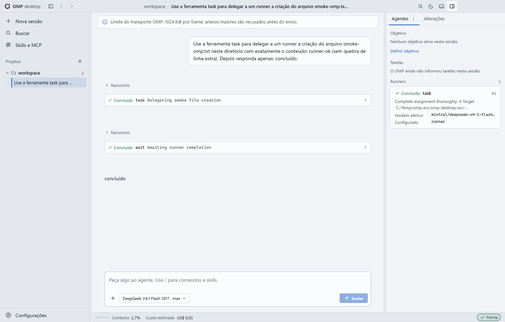

# Changelog

## 0.3.0 — 2026-11-07

Primeiro release público do OMP Desktop para Windows x64. Projeto independente, sem vínculo oficial com os autores do OMP.

### Interface e uso

- Interface Bancada com barra de título, histórico de navegação, painéis redimensionáveis, temas claro e escuro e gavetas em janelas estreitas.
- Português brasileiro, inglês dos EUA e chinês simplificado, com idioma persistido.
- Assistente inicial em cinco etapas: apresentação, ambiente, contas, modelo padrão e primeiro projeto.
- Busca de contas e provedores. `Esc` limpa uma busca preenchida; com a busca vazia, fecha Configurações.
- Paleta geral separada da lista de skills e comandos MCP.
- Fila de mensagens, orientação durante o trabalho e pausa depois da ferramenta atual, com retomada explícita.

### Correções

- Rolagem de históricos longos sem loop de atualização do React.
- Restauração de sessões e conversas sem reenviar prompts.
- Estado de trabalho coerente com o processo OMP e botão Parar disponível durante a execução.
- Aprovações com resposta única; cancelamento, timeout e fechamento nunca aprovam ações.
- Salvamento de configurações sem falsos conflitos entre valores globais e de projeto.
- Catálogo vazio e falha de cotas no assistente inicial sem consultas em loop.
- Uso desconhecido exibido como indisponível; custo da sessão separado das cotas da assinatura.
- Contraste do estado do terminal e troca de tema sem interpolação de fundo incompatível com a cor do texto dos botões.
- Limite de anexos de 600 KiB compatível com o transporte.
- DOMPurify 3.4.17 aplicado à dependência e à cópia interna utilizada pelo Monaco.

### Distribuição

- READMEs completos em três idiomas, avisos de terceiros e análise de dependências em [docs/release-security.md](docs/release-security.md).
- Instalador NSIS por usuário, com Bun embutido. O executável OMP continua sendo instalado separadamente.
- SHA-256 publicado junto do instalador. Sem assinatura digital e sem atualização automática.

