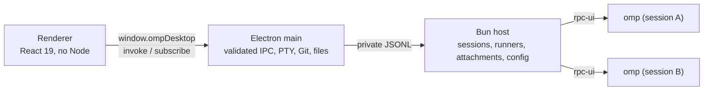

<div align="center">

# OMP Desktop

**OMP, now with a window.** Projects, sessions, runners, approvals, Git, and a terminal in one Windows and Linux app.


[English (US)](README.md) · [Português (Brasil)](docs/README.pt-BR.md) · [简体中文](docs/README.zh-CN.md)


</div>

---

> **Independent, unofficial project**
>
> OMP Desktop is an independent desktop client for [OMP](https://omp.sh) (oh-my-pi). It is not part of the OMP project and is not maintained or endorsed by its authors. The agent, models, credentials, and sessions all come from the OMP installation on your machine.
>
> The app does not use OpenCode as its engine, and no OpenCode code or trademark was copied. Third-party components and their copyright notices are listed in [`resources/licenses`](resources/licenses/NOTICE.txt).

## Contents

- [What it is](#what-it-is)
- [What it does not do](#what-it-does-not-do)
- [Release status](#release-status)
- [First run](#first-run)
- [Installation](#installation)
- [Features](#features)
- [Keyboard shortcuts](#keyboard-shortcuts)
- [Languages](#languages)
- [Where your data lives](#where-your-data-lives)
- [Development](#development)
- [Architecture](#architecture)
- [Security and privacy](#security-and-privacy)
- [Error recovery](#error-recovery)
- [Known limitations](#known-limitations)
- [Contributing](#contributing)
- [License and third-party components](#license-and-third-party-components)

## What it is

OMP Desktop is a Windows and Linux desktop application that gives OMP a real window. It **does not reimplement the agent**: every active session starts your own `omp --mode rpc-ui` process, in the project directory, with the same model, credentials, presets, and sessions you already use in the terminal. The app talks to that process over RPC and shows the conversation, runners, approvals, and changes.

In practice, the app is a window: the work is still done by the OMP installed on your machine. The desktop handles the interface, process lifecycle, terminal, Git panel, and project organization — not the agent's reasoning.

- **Windows x64 and Linux x86_64** desktop app built with **Electron 45**, **React 19**, and **Bun 1.4**.
- OMP handles the agent's reasoning and tool calls. Git actions, attachment handling, the PTY, and window management run locally in the Electron main process.
- No data migration: OMP sessions and configuration stay where OMP keeps them (`~/.omp`).
- First public release: **v0.3.0**; current version: **v0.3.1**. The project is pre-1.0: configuration keys, UI details, and internal contracts may change between releases.

### What it does not do

- **It is not another agent.** There is no built-in model and no second implementation of OMP.
- **It does not install OMP silently.** If OMP is missing on first run, the assistant offers an official installation after an explicit click; nothing is installed when the component mounts. You can also point to an existing OMP executable (`omp.exe` on Windows, `omp` on Linux) at any time.
- **It does not approve anything on its own.** Commands, targets, and details are visible before any confirmation.
- **It does not resend prompts.** When you reopen the app or recover from a crash, tabs return with their history, but nothing is sent again without your action.
- **It is not a fork of OMP.** This project is an independent desktop client.

## Release status

The current version is **0.3.1**, the final version of this release. The **v0.3.1** release includes **Windows x64 and Linux x86_64** in the same release. The previous public release was [v0.3.0](https://github.com/ricarossetto/omp-desktop/releases/tag/v0.3.0) (Windows x64 only).

The Windows installer is per-user, without administrator rights, and **not digitally signed**. The Linux packages are also unsigned. There is no auto-update on either platform: to upgrade, download or build the new package and install it over the current version. v0.3.0 started the public cycle; v0.3.1 is the current release, still pre-1.0.

## First run

On first launch, a five-step assistant prepares the environment:

1. **Welcome** — explains that the app uses your OMP, that nothing is approved on its own, and that tabs return without resending prompts. It also warns that the installer is unsigned.
2. **Environment** — checks OMP, the RPC protocol, the host Bun, Git, and the terminal/shell. If OMP is not found, the step offers **Install OMP**: nothing runs until you click **Install OMP**, the installation reports progress (resolving, downloading, verifying, activating) and ends in success or an actionable error, and on success the app detects the real executable and updates diagnostics without restarting, reopening the flow, or losing your draft or language. If installation fails, **Select OMP executable** remains available. The step also shows optional **Git** and **Node.js LTS** actions; neither is required to continue. The install methods are described in [Installing OMP from the app](#installing-omp-from-the-app) and [Installing optional tools](#installing-optional-tools).
3. **Accounts** — shows the usage OMP already knows, without displaying tokens. To add another account, open a project and use **Settings → Accounts**; login only starts with a click from you.
4. **Default model** — lists the models announced by OMP and lets you choose the global default. If the configuration changes outside the app, nothing is overwritten: the values are reloaded and you choose again.
5. **Theme and project** — chooses dark, light, or follow the system theme, shows the shortcuts, and lets you open your first folder. Finishing without opening a folder only closes the introduction; no project is created.

After that, open a folder, create a session, and start talking. Settings live in the command palette (`Ctrl+K`) and the gear icon.

## Installation

| System | Package | Status |
| --- | --- | --- |
| Windows 10/11 x64 | `OMP-Desktop-0.3.1-setup.exe` (NSIS, x64) | included in v0.3.1 |
| Debian 12/13, Ubuntu 24.04/26.04 x86_64 | `OMP-Desktop-0.3.1-linux-amd64.deb` | included in v0.3.1 |
| Linux x86_64 (TAR.GZ) | `OMP-Desktop-0.3.1-linux-x64.tar.gz` | included in v0.3.1 |
| Arch Linux x86_64 | `omp-desktop-0.3.1-1-x86_64.pkg.tar.zst` (PKGBUILD) | included in v0.3.1 |

The **v0.3.1** release publishes a single global `SHA256SUMS` covering all four artifacts. The previous v0.3.0 release remains available for Windows x64.

**OMP version support:** The validated baseline is 18.16.0, and the assisted installer pins exactly 18.16.0. The host accepts OMP major version 18 or newer; OMP 17 or older is rejected as incompatible. Versions newer than the 18.x series are accepted but marked as not validated. The same rule applies on Windows and Linux.

The application **does not include the OMP executable**. It includes the Bun runtime used by the local service and the `@oh-my-pi/pi-coding-agent` dependency (MIT), which is a host library — the agent remains the OMP executable from your installation or from the assisted install. Git and Node.js LTS are not bundled; both are optional. On Windows the app can install both; on Linux the app can install Node.js and shows the Git command for your package manager. Without Git, the Changes panel explains the absence and does not simulate a repository; the rest of the app keeps working.

### Windows

| Item | Detail |
| --- | --- |
| System | Windows x64 (Windows 10 or 11) |
| Installer | `OMP-Desktop-0.3.1-setup.exe` (NSIS, x64); the previous v0.3.0 installer keeps its 0.3.0 name |
| Scope | per-user; does not request administrator rights |
| Signature | unsigned; SmartScreen may warn |
| Bun | bundled at `resources/bun/bun.exe` |
| OMP | not bundled; first run can install the pinned official Windows x64 binary (18.16.0) after an explicit click, or you can select an existing `omp.exe` |
| Git | optional; only needed for the Changes panel; the app can install the official MinGit build on request |
| Node.js | optional; only needed for projects/MCP and the official npm; the app can install the current Node.js LTS on request |
| Updates | manual; there is no auto-update |

1. Download the installer from the [v0.3.1 release](https://github.com/ricarossetto/omp-desktop/releases/tag/v0.3.1) (tag `v0.3.1`, `OMP-Desktop-0.3.1-setup.exe`). The previous v0.3.0 installer keeps the 0.3.0 name.
2. If the release publishes a SHA-256, verify the file before running it (see below).
3. Run the installer. It installs into the user folder and does not request elevation.
4. Open OMP Desktop. The assistant checks the environment. If OMP is not found, choose **Install OMP**, or point to an existing `omp.exe`.
5. Open a project folder and create your first session.

### Linux (x86_64)

Linux packages are built from this source and are included in the **v0.3.1** release with Windows. v0.3.0 was Windows-only. This project does not publish an AUR package, PPA, AppImage, or auto-update channel. The planned targets are Debian 12 and 13, Ubuntu 24.04 and 26.04, and current Arch Linux, all x86_64 with glibc; ARM and macOS are out of scope.

| Item | Detail |
| --- | --- |
| System | Linux x86_64 (Debian 12/13, Ubuntu 24.04/26.04, Arch) |
| Packages | `OMP-Desktop-0.3.1-linux-amd64.deb`; `omp-desktop-0.3.1-1-x86_64.pkg.tar.zst` built from `packaging/arch/PKGBUILD` |
| Scope | system install under `/opt`; the app runs as your user |
| Signature | unsigned; verify `release/SHA256SUMS` |
| Bun | bundled at `resources/bun/bun` (official Bun 1.4.4 baseline, x86_64, mode 0755) |
| OMP | not bundled; first run can install the pinned official Linux x86_64 binary (18.16.0) after an explicit click into `$HOME/.local/bin/omp` (or `PI_INSTALL_DIR`), or you can select an existing `omp` |
| Git | optional; native only. The app never runs `sudo`, `apt`, or `pacman`; it shows the command for your distribution |
| Node.js | optional; the app can install the current official Node.js LTS `linux-x64` build into `$XDG_DATA_HOME/omp-desktop/tools/node` (default `~/.local/share/omp-desktop/tools/node`) |
| Updates | manual; there is no auto-update |

Build prerequisites: Linux x86_64 with glibc, Bun 1.4.4, Node.js for the Electron download step, and the packaging tools (`dpkg-deb` for the `.deb`; `base-devel`/`makepkg` for Arch). `libatomic.so.1` (`libatomic1` on Debian/Ubuntu, `libatomic` from `gcc-libs` on Arch) is required by the official Node.js binary and is a runtime dependency of both packages.

```bash
git clone https://github.com/ricarossetto/omp-desktop.git
cd omp-desktop
bun install --frozen-lockfile
node node_modules/electron/install.js   # only if lifecycle scripts were skipped
bun run build
bun run dist:linux                      # .deb + .tar.gz (+ Arch package when makepkg exists)
```

`bun scripts/dist-linux.ts --no-arch` builds only the `.deb` and the `.tar.gz`; `--clean` removes intermediate files. Outputs go to `release/` with `SHA256SUMS`. The build downloads the official Bun 1.4.4 baseline ZIP once, verifies its SHA-256 and the extracted binary, and writes `resources/bun/bun` with mode 0755.

Install the `.deb` on Debian or Ubuntu:

```bash
sudo apt install ./release/OMP-Desktop-0.3.1-linux-amd64.deb
```

`apt` resolves the Electron dependencies declared by the package. The app is installed under `/opt/omp-desktop`, with `/usr/bin/omp-desktop` and a desktop entry. On Ubuntu 24.04 and newer the package also installs an AppArmor profile; on systems without user namespaces, the `chrome-sandbox` helper is set to mode 4755. The app never runs with `--no-sandbox`. Git is only a `Suggests` and is not installed by default.

Build and install on Arch:

```bash
cd packaging/arch
makepkg -f
sudo pacman -U omp-desktop-0.3.1-1-x86_64.pkg.tar.zst
```

The PKGBUILD uses the local `OMP-Desktop-0.3.1-linux-x64.tar.gz` produced by `dist:linux` and installs under `/opt/omp-desktop` with `/usr/bin/omp-desktop`, icons, licenses, and `chrome-sandbox` mode 4755. It does **not** treat a hash calculated from the artifact as verification: it reads a trusted SHA-256 from `OMP_DESKTOP_ARCHIVE_SHA256`, or from `release/SHA256SUMS`/`<archive>.sha256`, and aborts if none is available. There is no `SKIP` and no URL to a release that does not exist. `makepkg` must not run as root. Git and Node.js are only `optdepends`.

From a source checkout, `bun run dist:linux` writes `release/OMP-Desktop-0.3.1-linux-x64.tar.gz` and `release/SHA256SUMS`; `cd packaging/arch && makepkg -f` picks both up.

The final delivery directory is flat: the TAR and `SHA256SUMS` are at its root, with `packaging/arch/PKGBUILD` below and **no `release/` folder**. From `packaging/arch`, pass the archive and the trusted hash explicitly:

```bash
cd packaging/arch
OMP_DESKTOP_ARCHIVE=../../OMP-Desktop-0.3.1-linux-x64.tar.gz \
OMP_DESKTOP_ARCHIVE_SHA256="$(grep ' OMP-Desktop-0.3.1-linux-x64.tar.gz$' ../../SHA256SUMS | cut -d' ' -f1)" \
makepkg -f
```

The hash comes from the delivered `SHA256SUMS`; do not replace it with a hash computed from the TAR itself. `OMP_DESKTOP_ARCHIVE` without `OMP_DESKTOP_ARCHIVE_SHA256` is rejected.

Uninstall:

```bash
sudo apt remove omp-desktop        # Debian/Ubuntu
sudo pacman -R omp-desktop         # Arch
```

Removing the package does not delete `$XDG_CONFIG_HOME/omp-desktop` (default `~/.config/omp-desktop`), the managed Node.js folder, or `~/.omp`.

#### Linux compatibility

| Distribution | Version | Status |
| --- | --- | --- |
| Debian | 12 | tested — install, launch, PTY and removal |
| Debian | 13 | tested — install, launch, PTY and removal |
| Ubuntu | 24.04 | tested — install, launch, PTY and removal |
| Ubuntu | 26.04 | tested — install, launch, PTY and removal |
| Arch Linux | current | tested — install, launch, PTY and removal |

Debian 12/13, Ubuntu 24.04/26.04, and current Arch Linux passed the real package checks (install, launch, PTY and removal) in non-root Docker containers with Xvfb; the sandbox stayed enabled. This is package/runtime validation on a shared kernel, not a claim of full native-VM coverage.

### Installing OMP from the app

If OMP is missing, the first-run assistant and the diagnostics screen offer **Install OMP**. After an explicit click on **Install OMP**, the app:

- resolves the pinned **18.16.0** binary through the same official build service used by OMP's installers (`build.stencil.so`), for the current platform and architecture (`windows-x86_64` on Windows x64, `linux-x86_64` on Linux x64);
- downloads it over HTTPS to `%LOCALAPPDATA%\omp\omp.exe` on Windows and to `$HOME/.local/bin/omp` on Linux, honoring `PI_INSTALL_DIR` like the official installer, without administrator rights; on Linux the binary receives mode 0755;
- verifies the SHA-256 published by the official service and runs `omp.exe --version` (Windows) or `omp --version` (Linux), requiring the exact pinned version before using the file;
- never overwrites an existing OMP executable: a compatible file is adopted, and an incompatible one is reported as a conflict while manual selection remains available.

On first launch without OMP, the app opens Diagnostics directly; the onboarding Environment step shows the same action. The app does not modify the persistent user PATH (or the Windows registry): it stores the absolute path in its own runtime state and adds the folder only to the PATH of its own processes (host and terminal). It does not touch `~/.omp`. Concurrent clicks share one installation, and closing the app during installation aborts the download and removes temporary files.

The bundled Bun is only the local host runtime; the OMP binary is standalone, so no global Bun installation is required. The renderer cannot supply a URL or command: the download host, file name, version, and arguments are fixed in the main process. On success, the app applies the detected path and updates onboarding/diagnostics without restarting or losing the draft or language. Network, checksum, version, write, activation, and cancellation errors are shown with a retry path (an activation failure keeps the installed binary), **Check again** re-probes the environment, and **Select OMP executable** remains available.

You can also install OMP manually by following the official instructions at [omp.sh](https://omp.sh) and then choosing **Select OMP executable**. The official commands are `irm https://omp.sh/install.ps1 | iex` in PowerShell on Windows and `curl -fsSL https://omp.sh/install | sh` in a terminal on Linux; the Linux script installs `omp` into `$HOME/.local/bin` by default. A global Bun is not required for the standalone binary.

### Installing optional tools

Git and Node.js LTS are optional. The app, OMP, and onboarding work without either; Bun is already bundled, and OMP does not require a system Node.js. The Environment step, Diagnostics, and **Settings → General** show the **Optional developer tools** section with the status of Git and Node.js LTS. On Windows, **Install Git** or **Install Node.js LTS** shows a **Before installing …** confirmation and the download only starts after **Download and install**. On Linux, **Install Node.js LTS** uses the same confirmation, while **Install Git** shows the package-manager command instead of downloading anything.

**Git (Changes panel, Windows).** The app installs the official Git for Windows [MinGit](https://gitforwindows.org/mingit.html) **2.56.0.windows.4** ZIP (the distribution Git for Windows documents for embedding) into `%LOCALAPPDATA%\omp-desktop\tools\git`, without an installer, administrator rights, winget, or MSI. It verifies the published SHA-256, extracts the ZIP safely, and runs `git.exe --version` before using it. The app adds `...\tools\git\cmd` only to its own process PATH. Manual alternative: [git-scm.com/download/win](https://git-scm.com/download/win).

**Node.js LTS (projects/MCP, Windows).** The app installs the **current Node.js LTS resolved from [nodejs.org](https://nodejs.org) at install time** (v26.13.0 at release) from the official Windows ZIP into `%LOCALAPPDATA%\omp-desktop\tools\node`, without an installer or administrator rights, including the official npm and npx. It verifies the SHA-256 from the official `SHASUMS256.txt`, extracts safely, and probes the executable before use. The app adds that folder only to its own process PATH. It does not install project or MCP dependencies; npm is available for you to run them. Manual alternative: [nodejs.org/en/download](https://nodejs.org/en/download).

**Git (Changes panel, Linux).** Git is native on Linux. The app never downloads MinGit, never runs `sudo`, `apt`, or `pacman`, and never asks for your password. **Install Git** shows the fixed command for your distribution — `sudo apt install git` on Debian/Ubuntu or `sudo pacman -S git` on Arch — which you run in your own terminal; **Check again** re-probes the environment. Manual reference: [git-scm.com/download/linux](https://git-scm.com/download/linux).

**Node.js LTS (projects/MCP, Linux).** The app installs the **current Node.js LTS resolved from [nodejs.org](https://nodejs.org) at install time** (v26.13.0 at release) from the official `linux-x64` TAR.GZ into `$XDG_DATA_HOME/omp-desktop/tools/node` (default `~/.local/share/omp-desktop/tools/node`), including the official npm and npx. It verifies the SHA-256 from the official `SHASUMS256.txt`, extracts the TAR.GZ with a safe reader that accepts only relative symlinks, and probes the executable before use. Only `<tools>/node/bin` is added to the app's own process PATH. The official Node binary needs `libatomic.so.1`: on Debian/Ubuntu install `libatomic1`, on Arch install `libatomic` (provided by `gcc-libs`). If the library is missing, the app reports it with that instruction instead of activating a broken tool. Manual alternative: [nodejs.org/en/download](https://nodejs.org/en/download).

On Windows, both installs are per-user and do not modify the persistent user or system PATH, the registry, or an existing global Git/Node.js installation. On Linux, the managed Node.js folder is per-user under the XDG data directory and no system package is changed; Git is never installed by the app. On both platforms, a compatible global tool on PATH is detected and adopted as-is; an incompatible or partial managed folder is reported, not overwritten. New terminals and newly spawned host/OMP child processes see the tools; running agents and terminals are not restarted or interrupted, and the next local service start also picks them up. Installations report progress (resolving, downloading, verifying, extracting, activating) and end in success or an actionable error with **Try again**; **Check again** re-probes the environment. After success, the row shows the installed version and location. Concurrent clicks share one installation per tool, and closing the app aborts the download and cleans up temporary files.

The renderer cannot supply a URL, version, command, or folder: sources, versions, destinations, and arguments are fixed in the main process. **Cancel** aborts the download and leaves the existing installation untouched. You can also install Git or Node.js manually from the official pages and use **Check again**.

### Installer verification

**Windows.** The installer is not digitally signed. Windows may show a SmartScreen warning; this is expected in this version.

- **Do not disable** SmartScreen, antivirus, or the Windows execution policy to install. If the warning blocks you, verify the origin and the hash; do not bypass the protection.
- Download only from the official repository and confirm that the file came from the expected release.
- If the release publishes a SHA-256, compare it with the output of:

```powershell
Get-FileHash .\OMP-Desktop-0.3.1-setup.exe -Algorithm SHA256
```

The previous v0.3.0 installer keeps the 0.3.0 name. If the hash does not match, do not run the file.

**Linux.** The `.deb` and the Arch package are not signed. Build them from this source or obtain them from a source you trust, and verify `release/SHA256SUMS` before installing:

```bash
cd release
sha256sum -c SHA256SUMS
```

Do not disable AppArmor, the sandbox, or your distribution's package verification to install the app. If the hash does not match, do not install the package.

### Uninstall

**Windows:** uninstalling removes the application. Data in `%APPDATA%\omp-desktop` and the `~/.omp` profile **are not deleted automatically**; remove them manually if you want to. The uninstaller does not promise to clean everything up.

**Linux:** `sudo apt remove omp-desktop` on Debian/Ubuntu or `sudo pacman -R omp-desktop` on Arch removes the application files. `$XDG_CONFIG_HOME/omp-desktop` (default `~/.config/omp-desktop`), the managed Node.js folder, and `~/.omp` are **not deleted automatically**.

On both platforms, **do not delete `~/.omp` just to uninstall the desktop app**: that profile belongs to OMP and holds accounts and sessions also used outside this app.

## Features

### Projects and sessions

- Open any folder as a project; recent projects are saved. A missing folder appears as unavailable and can be relocated. Removing a recent project never deletes files.
- The session list comes from OMP itself, without creating a parallel copy of the history.
- **One active session = one OMP process**, in the project directory. Switching tabs does not interrupt an agent that is working.
- A session in use by another process is not taken by force: the app warns you and offers to open another one.
- When you reopen the app, tabs return with the same conversation. **No prompt is resent**, even after a crash.
- The title bar has session history (Back/Forward, `Alt+←`/`Alt+→`), search, and a theme toggle. The sidebar shows the Git branch and the change count when the project is a repository.

### Conversation

- Markdown with tables (GFM), no raw HTML; code blocks with a copy button, collapsible thinking, and images. Remote images become links because of the CSP; local images and attachments appear in the conversation.
- Tool cards with intent, arguments, partial output in real time, result, and error. Very large results are paginated in the interface. The desktop no longer replaces history content with an omission marker to fit an 8 MiB display budget: messages, tool arguments, results, and `details` cross host → main → renderer intact. The OMP transport still has its own frame limit (1 MB by default; the host accepts JSONL lines up to 64 MiB), so a frame above the limit is rejected by OMP instead of being silently truncated.
- Long history is virtualized, with **Jump to answer** while you are reading older messages. The desktop no longer drops old messages or truncates content to fit an 8 MiB display budget; the OMP transport limit above still applies.
- `Enter` sends, `Shift+Enter` inserts a line break, and IME composition is respected. The draft and attachments are discarded only after OMP confirms receipt; if sending is refused, they remain.
- During a response, you choose: **Interrupt with steering** (delivered on the next step) or **Send after** (a queue with remove/promote). **Stop** recovers drafts and attachments from the queue.
- **Pause after current step** waits for the running tool to finish and returns control without losing anything; **Continue** resumes with an explicit message, without resending the previous one.
- **Rewind to here** and **Fork** act only on the conversation: no project file is restored, deleted, or changed. Later history remains in the OMP tree.
- Conversation export to HTML from the command palette.
- In the composer, `/` opens the commands OMP announces; skills, MCP, and extensions are still executed by OMP. The palette (`Ctrl+K`) has a general mode and a mode restricted to skills/MCP.
- Attachments through the button, drag and drop, or pasted image. Text files enter as a delimited block with name and content; PDFs and binaries become file references, not content sent to the model. The limit is **600 KiB per attachment**, because the whole prompt must fit in one OMP frame; the frame limit is checked before sending and nothing is silently truncated.

### Runners, tasks, and goal

- A panel shows each runner: agent, task, state, and **effective model**, separate from the configured model. If OMP does not report the effective model, **Model not reported** appears.
- Click to read the runner transcript incrementally. Completed cards remain accessible **after closing and reopening the app**.
- Cancel (with confirmation) or steer a specific runner; the others are unaffected.
- Tasks (`todo`) with blocked/abandoned states and goal control (`goal`): create, pause, resume, and discard.

### Approvals

- `select`, `confirm`, `input` (masked, with a reveal option), `editor`, and `ask` with multiple questions, multi-select, and a free-form answer.
- **The app never approves anything on its own.** Details, target, and command are visible before the decision.
- Each request is answered once; canceling or letting the deadline expire never becomes approval. When OMP has its own timeout for `ask`, the interface warns that it may proceed with the recommended options.
- Closing the session or losing the process cancels the request explicitly. Reloading the window does not lose a pending approval.

### Models, roles, and presets

- The active model (`set_model`), persisted roles (`modelRoles`), and presets (`modelPresets`) appear separately. The active model belongs to the session; roles and presets show the origin layer (global or project) and the effective value.
- Reasoning shows only the levels OMP announces; if the change fails, the previous choice is preserved.
- Applying a preset uses OMP's own `/modelpreset` command. If the version does not announce the command, the app warns and keeps the current preset.
- Editing has conflict detection: if another window or the terminal changed the value, nothing is overwritten; the screen reloads and you decide again.

### Accounts and usage

- Providers and connected accounts, with usage per window reported by OMP (for example, 5 hours, weekly, and monthly, when the provider announces those labels) through `omp usage --json`.
- Unknown usage appears as **Unavailable**, never as 0%. Session cost is labeled **estimated**, comes from `get_session_stats`, and is neither a charge nor a percentage of the subscription.
- Adding an account only after an explicit click. OAuth login happens in the external browser; when the provider requires interactive input, the app shows a command to run in the app terminal. Disconnecting asks for confirmation. Tokens never reach the interface.
- Search accounts and providers within the tab.

### Changes and Git

- Repository status with renames, untracked files, binaries, names with Unicode and spaces, and a repository without commits.
- **Working** and **index** diffs in the Monaco editor, local and without a CDN.
- Stage and unstage per file without touching the working tree. Commit only with a typed message and a click; a hook failure is shown and the files remain intact.
- No `push`, `reset`, `clean`, or automatic discard. Outside a repository, the panel explains the situation and does not run `git init`.
- Git is optional. If it is missing, the panel explains the absence; the optional action is available in Diagnostics and **Settings → General** (on Linux it shows the package-manager command). No repository is simulated.

### Integrated terminal

- A real PTY through node-pty (ConPTY on Windows, the POSIX PTY on Linux) with xterm. On Windows the shell is PowerShell when available, then `pwsh`, and finally `cmd.exe`; on Linux it uses `$SHELL` when it is an absolute executable path, then `/bin/bash`, `/usr/bin/bash`, `/bin/zsh`, and `/bin/sh`. Resize and `Ctrl+C` work, the working directory is the project folder, and output is not sent to the model automatically.

### Interface, theme, and languages

- Dark, light, or follow the system theme (the label still mentions Windows in this version); resizable panels with persisted sizes.
- Below 1000 px, the sidebar and the right panel become drawers; the conversation is never squeezed.
- Visible focus, keyboard navigation, accessible labels, and respect for `prefers-reduced-motion`.
- Portuguese (Brazil), English (US), and Simplified Chinese. The app follows the system language on first run; the choice lives in **Settings → General → Language**. Identifiers, commands, paths, and model names are not translated.

### Accessibility and quality

The interface was built with visible focus, keyboard navigation, accessible labels, and respect for reduced motion. Automated acceptance includes axe-core checks, but **automated reports have limits**: they do not replace testing with screen readers or validation with users. The project does not claim WCAG conformance and does not claim that the interface has been tested with screen readers.

## Keyboard shortcuts

| Shortcut | Action |
| --- | --- |
| `Ctrl+K` | Command palette and session search |
| `Ctrl+M` | Model and reasoning selector |
| `Ctrl+Shift+P` | Open project |
| `Ctrl+N` | New session |
| `Ctrl+B` | Toggle sidebar |
| ``Ctrl+` `` | Open or close the terminal |
| `Alt+←` / `Alt+→` | Back/forward through session history |
| `Esc` | Closes the palette, model selector, or settings; with an approval open, cancels the request (never approves); with nothing open and outside a text field, stops the agent |
| `Ctrl+Enter` | Sends in the dialog editor (`Enter` inserts a line break) |
| `Enter` / `Shift+Enter` | Send / insert a line break in the composer |

The `Ctrl+K` palette has two groups: the app's own actions and the OMP commands. The `/` palette in the composer lists the skills, MCP, and extension commands announced by OMP; all of them are executed by OMP.

## Languages

The app speaks Portuguese (Brazil), English (US), and Simplified Chinese. Dates and numbers follow the chosen language. Commands, identifiers, paths, and model names remain as OMP announces them.

## Where your data lives

| Location | What lives there |
| --- | --- |
| `%APPDATA%\omp-desktop` (Windows) | Desktop state: recent projects, tabs, layout, theme, window, attachments, logs, and the `host-data` subfolder of the local service |
| `%LOCALAPPDATA%\omp-desktop\tools\git` (Windows) | Managed Git installed by the app (optional) |
| `%LOCALAPPDATA%\omp-desktop\tools\node` (Windows) | Managed Node.js LTS and npm installed by the app (optional) |
| `$XDG_CONFIG_HOME/omp-desktop` (Linux; default `~/.config/omp-desktop`) | Desktop state: recent projects, tabs, layout, theme, window, attachments, logs, and the `host-data` subfolder of the local service |
| `$XDG_DATA_HOME/omp-desktop/tools/node` (Linux; default `~/.local/share/omp-desktop/tools/node`) | Managed Node.js LTS and npm installed by the app (optional) |
| `$HOME/.local/bin/omp` (Linux) | OMP installed by the app (or the `PI_INSTALL_DIR` you chose) |
| `~/.omp` | OMP profile: configuration, credentials, sessions, presets, and profiles |
| Project folder | Project files and the Git repository, when one exists |

The app does not copy credentials into the project or the repository. When opening issues, PRs, or screenshots, **do not include** credential files, personal logs, paths containing a username, emails, or account IDs.

## Development

Requirements: Windows x64 or Linux x86_64, Bun 1.4+, and Node.js available for the Electron download step. On Linux, `libatomic.so.1` is also required by the official Node.js binary (`libatomic1` on Debian/Ubuntu, `libatomic` from `gcc-libs` on Arch). OMP must be installed to test the app for real; Git is optional.

The Node.js used to download Electron is a development requirement. It is separate from the optional Node.js LTS that the app can install for projects/MCP; the app does not require a system Node.js to run.

Windows:

```powershell
git clone https://github.com/ricarossetto/omp-desktop.git C:\dev\omp-desktop
Set-Location C:\dev\omp-desktop
bun install --frozen-lockfile --ignore-scripts
node node_modules/electron/install.js
bun run dev
```

Linux:

```bash
git clone https://github.com/ricarossetto/omp-desktop.git
cd omp-desktop
bun install --frozen-lockfile
node node_modules/electron/install.js
bun run dev
```

| Command | What it does |
| --- | --- |
| `bun run dev` | Builds the host and opens the app in development mode |
| `bun run build` | Generates `out/` (main, preload, renderer, and host) |
| `bun run start` | Opens Electron from the build |
| `bun run build:host` | Builds only the Bun host |
| `bun run typecheck` | Type check |
| `bun run test` | Unit tests |
| `bun run test:acceptance` | Build + acceptance in real Electron with the test OMP (`tests/fixtures/fake-omp.ts`), without spending quota |
| `bun run dist:win` | Generates the NSIS x64 installer in `release/` |
| `bun run dist:linux` | Generates the `.deb` and `.tar.gz` in `release/`, plus the Arch package when `makepkg` exists |
| `bun run smoke:installed -- --exe "<path>\OMP Desktop.exe" --cwd "<folder>"` | Starts the installed Windows app outside the checkout, with a temporary `userData` |
| `bun run smoke:installed -- --exe /usr/bin/omp-desktop --cwd /tmp/omp-fixture` | Starts the installed Linux app outside the checkout, with a temporary `userData` |

The real smoke test uses the real OMP and **consumes quota** (one prompt with a runner). Run it deliberately:

```powershell
$env:REAL_OMP = "1"
bunx playwright test real-smoke
Remove-Item Env:REAL_OMP
```

On Linux, use `REAL_OMP=1 bunx playwright test real-smoke`. The normal acceptance test uses the test OMP and does not spend quota. The real smoke test should not run in public CI without credential and quota control.

Because the project pins `@oh-my-pi/pi-coding-agent` at 18.16.0, when running with Bun the `node_modules/.bin` can enter `PATH` and a local OMP shim may take precedence over the global `omp`. To point to the system OMP, use `OMP_DESKTOP_OMP_PATH` or select the OMP executable in diagnostics. The project baseline is 18.16.0; versions newer than the 18.x series are marked as not validated.

Automated checks cover repeatable behavior only and do not replace manual verification in a real environment. Before submitting a change, run at least the type check, unit tests, and acceptance tests; for UI changes, attach a screenshot of the real window.

## Architecture



```text
src/
  main/       window, IPC, PTY, Git, files, and host lifecycle
  host/       Bun service: RPC transport, sessions, runners, attachments, config
  renderer/   React 19: screens, conversation, panels, and dialogs
  preload/    the only bridge exposed to the renderer
  shared/     zod contracts and session reducer
scripts/      host build, installer, and installed-app smoke
tests/        unit tests, acceptance with test OMP, and real smoke
resources/    icon and license notices
docs/         screenshots and documentation
design/       visual and interaction brief
```

The contracts live in `src/shared/contracts.ts`; the pure reducer `applyEvent` in `src/shared/session-state.ts` is used by both the host and the renderer. Screens, states, and tokens are in [`design/opendesign-brief.md`](design/opendesign-brief.md).

The renderer has no Node, filesystem, or shell; only `invoke` and `subscribe`. Main talks to the host over private JSONL, and the host keeps one `omp --mode rpc-ui` process per active session, with `--resume <sessionPath>` when reopening and `--profile` when applicable. Protocol v2 is negotiated when available; the default frame is 1 MB (the host accepts JSONL lines up to 64 MiB) and attachments are limited to 600 KiB to fit in the prompt.

### Configuration scopes

| Scope | What it is | How the app changes it |
| --- | --- | --- |
| Session | Active model and reasoning level | Through RPC (`set_model`, `set_thinking_level`); does not change persisted roles |
| Project | Project `modelRoles` | In this version, edits only `modelRoles`; other overrides are displayed but not overwritten |
| Global | Global OMP profile layer; `modelRoles` and `modelPresets` | Through the OMP CLI (`omp config set`), with schema validation and conflict detection |

## Security and privacy

- Isolated renderer (`contextIsolation`, `sandbox`, no Node, no webview, local CSP). Only `invoke` and `subscribe` are exposed.
- Every IPC call validates the origin frame, the schema, and the association with the project, session, terminal, and attachment.
- Paths are always relative to the project, resolved with `realpath`, and reject `..`, NUL/control characters, and links pointing outside. Windows drive, UNC, and alternate-data-stream rules apply only on Windows.
- Files open outside the app only through an allowlist of harmless extensions; scripts and executables are only shown in the folder.
- Data sent to the interface and logs do not carry tokens, authentication headers, or `providerPayload`. Logs redact keys and values that look like secrets, including home directories.
- Processes are terminated only by the process tree the app started, never by name. On Linux, a signal requires the captured process identity (creation time from `/proc`), and a PID or executable name alone never authorizes a kill.
- The app has no telemetry of its own; network traffic is that of OMP and the providers you configured, plus the official OMP build service and the official Node.js sources when you choose those install actions. On Linux, Git is never downloaded.
- The OMP installation offered on first run uses the official binary from the official build service, pinned to 18.16.0, verifies the published SHA-256 and `omp --version`, writes only to `%LOCALAPPDATA%\omp` on Windows or `$HOME/.local/bin/omp` on Linux (or `PI_INSTALL_DIR`), marks the Linux binary executable, and never overwrites an existing file; the renderer cannot supply a URL or command.
- Optional Node.js installs use fixed official sources, verify SHA-256, extract safely, never overwrite an existing global tool, and do not modify the persistent PATH or registry; only the app process PATH is extended. On Linux, the managed folder is under the XDG data directory and Git is installed only by your own package manager, with the command shown in the app.

**Important limit:** redaction protects transport fields and logs, but **it is not a promise to erase sensitive content you type into the conversation**. Text, tool arguments, and results are preserved literally for the agent and may remain in the OMP transcript. Do not paste secrets into the chat; if you do, remove the history using OMP's tools and revoke the credential. The app cannot guarantee removal of what OMP has already recorded.

Dependency auditing and the release process are described in [`docs/release-security.md`](docs/release-security.md). To report a vulnerability, follow [`SECURITY.md`](SECURITY.md) — do not open a public issue.

## Error recovery

| Situation | What happens |
| --- | --- |
| OMP not found | The diagnostics screen shows the state and offers **Install OMP** (official pinned binary after an explicit click) and **Select OMP executable**; nothing is installed silently, and a failed install keeps manual selection available for retry |
| OMP 17 or older | Rejected as incompatible. Use **Install OMP** or update OMP before continuing |
| OMP crashes during the session | The session is marked as interrupted, the transcript is preserved, and no prompt is resent; the draft can be recovered |
| Local service fails | Diagnostics shows `host-failed`; persisted tabs remain saved and reopen without a prompt when the service returns |
| Configuration changed outside the app | Saving detects the conflict, reloads the values, and overwrites nothing |
| Session in use by another process | The app warns and does not open it by force; close the other process or choose another session |
| Git missing | The Changes panel explains that Git is not on `PATH`; the optional action is available in Diagnostics and **Settings → General**. On Linux it shows the `apt`/`pacman` command and never runs it for you. The rest of the app works |
| Node.js missing | Projects or MCP that need Node.js/npm are unavailable until it is installed; the optional install action is available in Diagnostics and **Settings → General**. The app and OMP work without it |
| `libatomic.so.1` missing on Linux | The Node.js installer reports the missing system library and the package command (`libatomic1` on Debian/Ubuntu, `libatomic` from `gcc-libs` on Arch); nothing is activated |
| Linux sandbox unavailable | The packages install the AppArmor profile on Ubuntu 24.04+ or set `chrome-sandbox` to mode 4755 on Arch; the app never runs with `--no-sandbox` |
| Optional tool install fails | A localized error with retry is shown; nothing is overwritten, and a manual install remains possible |
| Folder is not a repository | The panel explains and does not run `git init`; to version it, use the terminal deliberately |
| Commit refused by a hook | The error is displayed and the files remain intact |
| Unsigned package | On Windows, SmartScreen may warn; on Linux the packages are unsigned. Verify the origin and SHA-256 and do not disable security |
| Uninstall | The application is removed; `%APPDATA%\omp-desktop` or `~/.config/omp-desktop`, plus `~/.omp`, remain |

## Known limitations

- **Platforms: Windows x64 and Linux x86_64.** The Linux scope is Debian 12/13, Ubuntu 24.04/26.04, and current Arch Linux. There are no ARM, macOS, AppImage, AUR, or PPA builds. The v0.3.1 release includes Linux in the same release as Windows; v0.3.0 was Windows-only.
- **No auto-update.** Download or build the new package and install it over the current version.
- **OMP is not bundled.** The first-run assistant can install the pinned official binary (18.16.0) for the current platform after an explicit click, but it does not update OMP silently; a compatible OMP executable (major version 18 or newer; validated at 18.16.0) is required.
- **No permission-mode selector of its own.** The app shows the approvals OMP sends and does not invent permission levels the RPC does not announce.
- **Git and Node.js LTS are optional and not bundled.** On Windows the app can install both on request; on Linux it can install Node.js and shows the Git command for your package manager. Neither is updated silently; a compatible global installation is detected and used as-is.
- **Git without `push`, `reset`, `clean`, or discard.** The panel covers status, diff, stage, unstage, and commit.
- **Unsigned packages.** The Windows installer may trigger SmartScreen; the Linux packages are also unsigned. There is no code-signing certificate in this version.
- **Attachments limited to 600 KiB per file** and to OMP's default 1 MB frame. History is no longer capped at 8 MiB by the desktop, but remains subject to the OMP transport frame limit (1 MB default; host JSONL lines up to 64 MiB).
- **No WCAG conformance claim** and no documented testing with screen readers or users. Automated checks have limits.
- **v0.3.0 was the first public release; v0.3.1 is the current release.** Some rough edges are expected, and it is not 1.0.

## Contributing

Read [`CONTRIBUTING.md`](CONTRIBUTING.md) before opening an issue or PR. In short:

- Run `bun run typecheck`, `bun run test`, and `bun run test:acceptance` before submitting.
- Describe the system (Windows x64 or Linux x86_64, with the distribution and version), the app version, and the OMP version (`omp --version`).
- One change per PR, with the reason in the title. If you change the interface, attach a screenshot of the real window.
- Do not include personal data (paths containing a username, emails, tokens) in screenshots, fixtures, or logs.
- For security issues, use [`SECURITY.md`](SECURITY.md), not a public issue.

## License and third-party components

OMP Desktop is distributed under the **MIT** license. See [`LICENSE`](LICENSE).

Third-party notices are in [`resources/licenses/NOTICE.txt`](resources/licenses/NOTICE.txt). Distributed components include `@oh-my-pi/pi-coding-agent`, zod, `@lydell/node-pty`, React, React DOM, react-markdown, remark-gfm, xterm, Monaco, and Electron, all with their licenses preserved. The build uses electron-builder. The Bun runtime is included in the package as `resources/bun/bun.exe` on Windows and `resources/bun/bun` on Linux; the OMP executable is **not** redistributed.

Architecture and UX references from open-source projects were studied; no proprietary code was copied. MIT components keep their copyright notices.
