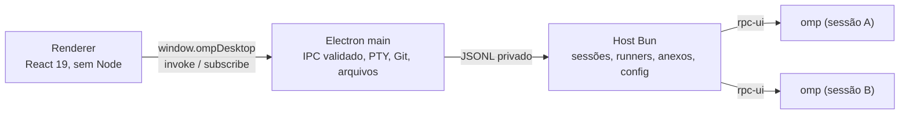

<div align="center">

# OMP Desktop

**O OMP com janela de verdade.** Projetos, sessões, runners, aprovações, Git e terminal em um aplicativo Windows.


[Português (Brasil)](README.md) | [English (US)](docs/README.en-US.md) | [简体中文](docs/README.zh-CN.md)


</div>

---

> **Projeto independente e não oficial.** O OMP Desktop não é afiliado, mantido nem endossado pelos autores do oh-my-pi/OMP. É um cliente desktop que conversa com o OMP instalado na sua máquina. O agente, os modelos, as credenciais e as sessões continuam sendo do OMP.

## Sumário

- [O que é](#o-que-é)
- [O que ele não faz](#o-que-ele-não-faz)
- [Estado do release](#estado-do-release)
- [Primeiro uso](#primeiro-uso)
- [Instalação](#instalação)
- [Funcionalidades](#funcionalidades)
- [Atalhos](#atalhos)
- [Idiomas](#idiomas)
- [Onde ficam os dados](#onde-ficam-os-dados)
- [Desenvolvimento](#desenvolvimento)
- [Arquitetura](#arquitetura)
- [Segurança e privacidade](#segurança-e-privacidade)
- [Recuperação de erros](#recuperação-de-erros)
- [Limitações conhecidas](#limitações-conhecidas)
- [Contribuição](#contribuição)
- [Licença e componentes de terceiros](#licença-e-componentes-de-terceiros)

## O que é

O OMP Desktop é uma interface gráfica para o [OMP](https://omp.sh) (oh-my-pi). Ele **não reimplementa o agente**: cada sessão ativa inicia o próprio `omp --mode rpc-ui`, no diretório do projeto, com o mesmo modelo, as mesmas credenciais, os mesmos presets e as mesmas sessões que você já usa no terminal. O aplicativo conversa com esse processo por RPC e mostra a conversa, os runners, as aprovações e as alterações.

Na prática, o app é uma janela: o trabalho continua sendo feito pelo OMP que está instalado na sua máquina. O desktop cuida da interface, do ciclo de vida dos processos, do terminal, do painel Git e da organização dos projetos — não do raciocínio do agente.

### O que ele não faz

- **Não é outro agente.** Não existe um modelo embutido nem uma segunda implementação do OMP.
- **Não instala nem atualiza o OMP.** Se o executável não estiver disponível, o diagnóstico permite apontar o `omp.exe` manualmente.
- **Não aprova nada sozinho.** Comandos, alvos e detalhes ficam visíveis antes de qualquer confirmação.
- **Não reenvia prompts.** Ao reabrir o app ou depois de uma queda, as abas voltam com o histórico, mas nada é enviado de novo sem uma ação sua.
- **Não é um fork do OMP.** O projeto é um cliente desktop independente.

## Estado do release

A versão atual é **0.3.0**, a primeira versão pública. Baixe em [github.com/ricarossetto/omp-desktop/releases/latest](https://github.com/ricarossetto/omp-desktop/releases/latest) (tag `v0.3.0`).

O instalador é **Windows x64**, por usuário, sem necessidade de administrador e **sem assinatura digital**. Não há atualização automática: para atualizar, baixe o novo instalador e instale por cima. A v0.3.0 é o começo do ciclo público; trate como software em evolução, não como 1.0.

## Primeiro uso

Na primeira execução, um assistente em cinco passos prepara o ambiente:

1. **Boas-vindas** — explica que o app usa o seu OMP, que nada é aprovado sozinho e que as abas voltam sem reenviar prompts. Também avisa que o instalador não é assinado.
2. **Ambiente** — confere OMP, protocolo RPC, Bun do host, Git e terminal/shell. Nada é instalado automaticamente. Se o OMP não for encontrado, use **Selecionar omp.exe** ou **Abrir diagnóstico**.
3. **Contas** — mostra o uso que o OMP já conhece, sem exibir tokens. Para adicionar outra conta, abra um projeto e use **Configurações → Contas**; o login só começa com um clique seu.
4. **Modelo padrão** — lista os modelos anunciados pelo OMP e permite escolher o padrão global. Se a configuração mudar fora do aplicativo, nada é sobrescrito: os valores são recarregados e você escolhe de novo.
5. **Tema e projeto** — escolhe tema escuro, claro ou igual ao Windows, mostra os atalhos e permite abrir a primeira pasta. Concluir sem abrir uma pasta apenas fecha a introdução; nenhum projeto é criado.

Depois disso, abra uma pasta, crie uma sessão e converse. As configurações ficam na paleta de comandos (`Ctrl+K`) e no ícone de engrenagem.

## Instalação

| Item | Detalhe |
| --- | --- |
| Sistema | Windows x64 |
| Instalador | `OMP-Desktop-0.3.0-setup.exe` (NSIS, x64) |
| Escopo | por usuário; não pede administrador |
| Assinatura | não assinado; o SmartScreen pode avisar |
| Bun | embutido em `resources/bun/bun.exe` |
| OMP | não incluído; requer `omp.exe` 18.16+ (validado em 18.16.0) |
| Git | opcional; necessário apenas para o painel Alterações |
| Atualização | manual; não há auto-update |

1. Baixe o instalador no [release mais recente](https://github.com/ricarossetto/omp-desktop/releases/latest) (tag `v0.3.0`).
2. Se o release publicar um SHA256, confira o arquivo antes de executar (veja abaixo).
3. Execute o instalador. Ele instala na pasta do usuário e não pede elevação.
4. Abra o OMP Desktop. O assistente confere o ambiente; se o OMP não for encontrado, aponte o `omp.exe`.
5. Abra uma pasta de projeto e crie a primeira sessão.

O instalador **não inclui o executável do OMP**. Ele inclui o runtime Bun usado pelo serviço local e a dependência `@oh-my-pi/pi-coding-agent` (MIT), que é uma biblioteca do host — o agente continua sendo o `omp.exe` da sua instalação. O Git é opcional: sem ele, o painel Alterações explica a ausência e não simula um repositório; o restante do app continua funcionando.

### SmartScreen e verificação do instalador

O instalador não é assinado digitalmente. O Windows pode exibir um aviso do SmartScreen; isso é esperado nesta versão.

- **Não desative** o SmartScreen, o antivírus ou a política de execução do Windows para instalar. Se o aviso impedir, verifique a origem e o hash; não contorne a proteção.
- Baixe apenas do repositório oficial e confira se o arquivo veio do release esperado.
- Se o release publicar um SHA256, compare com o resultado de:

```powershell
Get-FileHash .\OMP-Desktop-0.3.0-setup.exe -Algorithm SHA256
```

Se o hash não bater, não execute o arquivo.

### Desinstalação

Desinstalar remove o aplicativo. Os dados em `%APPDATA%\omp-desktop` e o perfil `~/.omp` **não são apagados automaticamente**; se quiser removê-los, faça isso manualmente. O instalador não promete limpar tudo.

## Funcionalidades

### Projetos e sessões

- Abra qualquer pasta como projeto; os recentes ficam salvos. Pasta ausente aparece como indisponível e pode ser relocalizada. Remover um recente nunca apaga arquivos.
- A lista de sessões vem do próprio OMP, sem criar uma cópia paralela do histórico.
- **Uma sessão ativa = um processo OMP próprio**, no diretório do projeto. Trocar de aba não interrompe um agente que está trabalhando.
- Sessão em uso por outro processo não é tomada à força: o app avisa e oferece abrir outra.
- Ao reabrir o aplicativo, as abas voltam com a mesma conversa. **Nenhum prompt é reenviado**, nem depois de uma queda.
- A barra de título tem histórico de sessões (Voltar/Avançar, `Alt+←`/`Alt+→`), busca e alternância de tema. A barra lateral mostra o ramo Git e a contagem de alterações quando o projeto é um repositório.

### Conversa

- Markdown com tabelas (GFM), sem HTML cru; blocos de código com botão copiar, raciocínio (thinking) recolhível e imagens. Imagens remotas viram link por causa da CSP; imagens locais e anexos aparecem na conversa.
- Cards de ferramenta com intenção, argumentos, saída parcial em tempo real, resultado e erro. Resultados muito grandes são paginados na interface e, quando excedem o orçamento de transporte, aparecem com uma marca explícita de omissão — o dado completo continua salvo no OMP.
- Histórico longo virtualizado, com **“Ir para a resposta”** quando você está lendo mensagens antigas.
- Enter envia, Shift+Enter quebra linha, composição por IME é respeitada. O rascunho e os anexos só são descartados depois que o OMP confirma o recebimento; se o envio for recusado, eles permanecem.
- Durante a resposta, você escolhe: **Interromper com orientação** (steer, entregue no próximo passo) ou **Enviar depois** (fila com remover/promover). **Parar** recupera rascunhos e anexos da fila.
- **Pausar depois do passo atual** espera a ferramenta em curso terminar e devolve o controle sem perder nada; **Continuar** retoma com uma mensagem explícita, sem reenviar a anterior.
- **Voltar até aqui** e **Ramificar** agem apenas na conversa: nenhum arquivo do projeto é restaurado, apagado ou alterado. O histórico posterior continua na árvore do OMP.
- Exportação da conversa em HTML pela paleta de comandos.
- No compositor, `/` abre os comandos que o OMP anuncia; skills, MCP e extensões continuam sendo executados pelo OMP. A paleta (`Ctrl+K`) tem um modo geral e um modo restrito a skills/MCP.
- Anexos por botão, arrastar e colar imagem. Arquivos de texto entram como bloco delimitado com nome e conteúdo; PDFs e binários viram referência de arquivo, não conteúdo enviado ao modelo. O limite é de **600 KiB por anexo**, porque o prompt inteiro precisa caber em um frame do OMP; o limite do frame é checado antes do envio e nada é truncado silenciosamente.

### Runners, tarefas e objetivo

- Painel com cada runner: agente, tarefa, estado e **modelo efetivo**, diferenciado do modelo configurado. Se o OMP não informar o efetivo, aparece “Modelo não informado”.
- Clique para ler o transcript do runner de forma incremental. Cards finalizados continuam acessíveis **mesmo depois de fechar e reabrir o app**.
- Cancelar (com confirmação) ou orientar um runner específico; os outros não são afetados.
- Tarefas (`todo`) com estados bloqueado/abandonado e controle de objetivo (`goal`): criar, pausar, retomar e descartar.

### Aprovações

- `select`, `confirm`, `input` (com máscara e opção de revelar), `editor` e `ask` com várias perguntas, multisseleção e resposta livre.
- **O aplicativo nunca aprova nada sozinho.** Detalhes, alvo e comando ficam visíveis antes da decisão.
- Cada pedido é respondido uma única vez; cancelar ou deixar o prazo vencer não vira aprovação. Quando o OMP tem timeout próprio para `ask`, a interface avisa que ele pode seguir com as opções recomendadas.
- Fechar a sessão ou perder o processo cancela o pedido explicitamente. Recarregar a janela não perde uma aprovação pendente.

### Modelos, papéis e presets

- Modelo ativo (`set_model`), papéis persistidos (`modelRoles`) e presets (`modelPresets`) aparecem separados. O modelo ativo é da sessão; papéis e presets mostram a camada de origem (global ou projeto) e o valor efetivo.
- O raciocínio mostra apenas os níveis que o OMP anuncia; se a troca falhar, a escolha anterior é preservada.
- Aplicar um preset usa o comando `/modelpreset` do próprio OMP. Se a versão não anunciar o comando, o app avisa e mantém o preset atual.
- A edição tem detecção de conflito: se outra janela ou o terminal mudou o valor, nada é sobrescrito; a tela recarrega e você decide de novo.

### Contas e cotas

- Provedores e contas conectadas, com uso por janela informado pelo OMP (por exemplo, 5 h, semanal e mensal, quando o provedor anuncia esses rótulos) via `omp usage --json`.
- Uso desconhecido aparece como **Indisponível**, nunca como 0%. Custo da sessão é rotulado **“estimado”**, vem de `get_session_stats` e não é débito nem percentual da assinatura.
- Adicionar conta só depois de clique explícito. O login OAuth acontece no navegador externo; quando o provedor exige entrada interativa, o app mostra um comando para rodar no terminal do aplicativo. Desconectar pede confirmação. Tokens nunca chegam à interface.
- Busca de contas e provedores dentro da aba.

### Alterações e Git

- Status do repositório com renomeações, não rastreados, binários, nomes com Unicode e espaços, e repositório sem commits.
- Diff **working** e **index** no editor Monaco, local e sem CDN.
- Stage e unstage por arquivo sem tocar na árvore de trabalho. Commit só com mensagem digitada e clique; falha de hook é exibida e os arquivos ficam intactos.
- Sem `push`, `reset`, `clean` ou descarte automático. Fora de um repositório, o painel explica e não roda `git init`.

### Terminal integrado

- PTY real via node-pty (ConPTY no Windows) com xterm: PowerShell quando disponível, depois `pwsh`, por último `cmd.exe`. Resize e `Ctrl+C` funcionam, a pasta é a do projeto e a saída não é enviada ao modelo automaticamente.

### Interface, tema e idiomas

- Tema escuro, claro ou igual ao Windows; painéis redimensionáveis e persistidos.
- Abaixo de 1000 px, a barra lateral e o painel direito viram gavetas; a conversa nunca fica espremida.
- Foco visível, navegação por teclado, rótulos acessíveis e respeito a `prefers-reduced-motion`.
- Português (Brasil), English (US) e 简体中文. O aplicativo segue o idioma do Windows na primeira execução; a escolha fica em **Configurações → Geral → Idioma**. Identificadores, comandos, caminhos e nomes de modelo não são traduzidos.

### Acessibilidade e qualidade

A interface foi construída com foco visível, navegação por teclado, rótulos acessíveis e respeito a movimento reduzido. A aceitação automatizada inclui verificações com axe-core, mas **relatórios automatizados têm limites**: eles não substituem testes com leitores de tela nem validação com pessoas usuárias. O projeto não declara conformidade WCAG e não afirma que a interface foi testada com leitores de tela.

## Atalhos

| Atalho | Ação |
| --- | --- |
| `Ctrl+K` | Paleta de comandos e busca de sessões |
| `Ctrl+M` | Seletor de modelo e raciocínio |
| `Ctrl+Shift+P` | Abrir projeto |
| `Ctrl+N` | Nova sessão |
| `Ctrl+B` | Alternar barra lateral |
| ``Ctrl+` `` | Abrir ou fechar o terminal |
| `Alt+←` / `Alt+→` | Voltar/avançar no histórico de sessões |
| `Esc` | Fecha paleta, seletor de modelo ou configurações; com uma aprovação aberta, cancela o pedido (nunca aprova); sem nada aberto e fora de um campo de texto, interrompe o agente |
| `Ctrl+Enter` | Envia no editor de diálogo (Enter quebra linha) |
| `Enter` / `Shift+Enter` | Envia / quebra linha no compositor |

## Idiomas

O aplicativo fala português (Brasil), inglês (US) e chinês simplificado. Datas e números seguem o idioma escolhido. Comandos, identificadores, caminhos e nomes de modelo permanecem como o OMP os anuncia.

## Onde ficam os dados

| Local | O que fica lá |
| --- | --- |
| `%APPDATA%\omp-desktop` | Estado do desktop: projetos recentes, abas, layout, tema, janela, anexos, logs e a subpasta `host-data` do serviço local |
| `~/.omp` | Perfil do OMP: configuração, credenciais, sessões, presets e perfis |
| Pasta do projeto | Arquivos do projeto e o repositório Git, quando existir |

O aplicativo não copia credenciais para o projeto nem para o repositório. Ao abrir issues, PRs ou capturas, **não inclua** arquivos de credenciais, logs pessoais, caminhos com nome de usuário, e-mails ou IDs de conta.

## Desenvolvimento

Requisitos: Windows x64, Bun 1.4+ e Node.js disponível para o passo de download do Electron. O OMP precisa estar instalado para testar o app de verdade; Git é opcional.

```powershell
git clone https://github.com/ricarossetto/omp-desktop.git C:\dev\omp-desktop
Set-Location C:\dev\omp-desktop
bun install --frozen-lockfile --ignore-scripts
node node_modules/electron/install.js
bun run dev
```

| Comando | O que faz |
| --- | --- |
| `bun run dev` | Compila o host e abre o app em modo desenvolvimento |
| `bun run build` | Gera `out/` (main, preload, renderer e host) |
| `bun run start` | Abre o Electron a partir do build |
| `bun run build:host` | Compila somente o host Bun |
| `bun run typecheck` | Checagem de tipos |
| `bun run test` | Testes unitários |
| `bun run test:acceptance` | Build + aceitação em Electron real com o OMP de teste (`tests/fixtures/fake-omp.ts`), sem gastar cota |
| `bun run dist:win` | Gera o instalador NSIS x64 em `release/` |
| `bun run smoke:installed -- --exe "<caminho>\OMP Desktop.exe" --cwd "<pasta>"` | Inicia o app instalado, fora do checkout, com `userData` temporário |

O smoke real usa o OMP de verdade e **consome cota** (um prompt com runner). Rode conscientemente:

```powershell
$env:REAL_OMP = "1"
bunx playwright test real-smoke
Remove-Item Env:REAL_OMP
```

O teste de aceitação normal usa o OMP de teste e não gasta cota. O smoke real não deve ser executado em CI público sem controle de credenciais e cota.

Como o projeto fixa `@oh-my-pi/pi-coding-agent` em 18.16.0, ao rodar com Bun o `node_modules/.bin` pode entrar no PATH e um shim local do OMP pode prevalecer sobre o `omp` global. Para apontar o OMP do sistema, use `OMP_DESKTOP_OMP_PATH` ou selecione o `omp.exe` no diagnóstico. A baseline do projeto é 18.16.0; versões mais antigas que 18.16 geram aviso.

## Arquitetura



```text
src/
  main/       janela, IPC, PTY, Git, arquivos e ciclo do host
  host/       serviço Bun: transporte RPC, sessões, runners, anexos, config
  renderer/   React 19: telas, conversa, painéis e diálogos
  shared/     contratos zod e reducer de sessão
scripts/      build do host, instalador e smoke do app instalado
tests/        unitários, aceitação com OMP de teste e smoke real
resources/    ícone e avisos de licenças
docs/         capturas e documentação
design/       brief visual e de interação
```

Os contratos ficam em `src/shared/contracts.ts`; o reducer puro `applyEvent` em `src/shared/session-state.ts` é usado pelo host e pelo renderer. Telas, estados e tokens estão em [`design/opendesign-brief.md`](design/opendesign-brief.md).

O renderer não tem Node, sistema de arquivos nem shell; só `invoke` e `subscribe`. O main fala com o host por JSONL privado, e o host mantém um processo `omp --mode rpc-ui` por sessão ativa, com `--resume <sessionPath>` ao reabrir e `--profile` quando aplicável. O protocolo v2 é negociado quando disponível; o frame padrão é de 1 MB e os anexos ficam limitados a 600 KiB para caber no prompt.

### Escopo das configurações

| Escopo | O que é | Como o app mexe |
| --- | --- | --- |
| Sessão | Modelo ativo e nível de raciocínio | Via RPC (`set_model`, `set_thinking_level`); não altera papéis persistidos |
| Projeto | `modelRoles` do projeto | Nesta versão, edita somente `modelRoles`; outros overrides são exibidos, mas não sobrescritos |
| Global | Camada global do perfil OMP; `modelRoles` e `modelPresets` | Via CLI do OMP (`omp config set`), com validação de esquema e detecção de conflito |

## Segurança e privacidade

- Renderer isolado (`contextIsolation`, `sandbox`, sem Node, sem webview, CSP local). Só `invoke` e `subscribe` são expostos.
- Todo IPC valida o frame de origem, o schema e a associação com projeto, sessão, terminal e anexo.
- Caminhos são sempre relativos ao projeto, com `realpath`, e recusam `..`, UNC, streams alternativos e links para fora.
- Arquivos só abrem fora do app por lista de extensões inofensivas; scripts e executáveis apenas aparecem na pasta.
- Dados enviados à interface e logs não carregam tokens, cabeçalhos de autenticação nem `providerPayload`. Os logs redigem chaves e valores com aparência de segredo.
- Processos são encerrados apenas pela árvore de PIDs que o app iniciou, nunca por nome.
- O aplicativo não tem telemetria própria; o tráfego de rede é o do OMP e dos provedores que você configurou.

**Limite importante:** a redação protege campos de transporte e logs, mas **não é uma promessa de apagar conteúdo sensível que você digitar na conversa**. Texto, argumentos de ferramenta e resultados são preservados literalmente para o agente e podem ficar no transcript do OMP. Não cole segredos no chat; se colar, remova o histórico conforme as ferramentas do OMP e revogue a credencial. O aplicativo não consegue garantir a remoção do que já foi gravado pelo OMP.

A auditoria de dependências e o processo de release estão descritos em [`docs/release-security.md`](docs/release-security.md). Para reportar uma falha, siga o [`SECURITY.md`](SECURITY.md) — não abra issue pública.

## Recuperação de erros

| Situação | O que acontece |
| --- | --- |
| OMP não encontrado | O diagnóstico mostra o estado e permite selecionar o `omp.exe`; nada é instalado automaticamente |
| OMP mais antigo que 18.16 | Não é suportado. A abertura da sessão pode ser recusada pelo host; atualize o OMP antes de continuar |
| OMP cai durante a sessão | A sessão é marcada como interrompida, o transcript é preservado e nenhum prompt é reenviado; o rascunho pode ser recuperado |
| Serviço local falha | O diagnóstico mostra `host-failed`; as abas persistidas continuam salvas e reabrem sem prompt quando o serviço volta |
| Configuração mudou fora do app | A gravação detecta o conflito, recarrega os valores e não sobrescreve nada |
| Sessão em uso por outro processo | O app avisa e não abre à força; feche o outro processo ou escolha outra sessão |
| Git ausente | O painel Alterações explica que o Git não está no PATH; o restante do app funciona |
| Pasta não é um repositório | O painel explica e não roda `git init`; se quiser versionar, use o terminal conscientemente |
| Commit recusado por hook | O erro é exibido e os arquivos permanecem intactos |
| Instalador não assinado | O SmartScreen pode avisar; verifique origem e SHA256 e não desative a segurança |
| Desinstalação | O aplicativo é removido; `%APPDATA%\omp-desktop` e `~/.omp` permanecem |

## Limitações conhecidas

- **Somente Windows x64.** Não há instalador para macOS ou Linux.
- **Sem atualização automática.** Baixe o novo instalador e instale por cima.
- **Sem OMP automático.** O app não instala nem atualiza o OMP; você precisa ter um `omp.exe` compatível (18.16+; validado em 18.16.0).
- **Sem seletor de modo de permissão próprio.** O app mostra as aprovações que o OMP envia e não inventa níveis de permissão que o RPC não anuncia.
- **Git sem `push`, `reset`, `clean` ou descarte.** O painel cobre status, diff, stage, unstage e commit.
- **Instalador não assinado.** O SmartScreen pode avisar; não há certificado de code signing nesta versão.
- **Anexos limitados a 600 KiB por arquivo** e ao frame padrão de 1 MB do OMP.
- **Sem declaração de conformidade WCAG** e sem teste documentado com leitores de tela ou pessoas usuárias. As verificações automatizadas têm limites.
- **v0.3.0 é a primeira versão pública.** Algumas arestas são esperadas; não trate como 1.0.

## Contribuição

Leia o [`CONTRIBUTING.md`](CONTRIBUTING.md) antes de abrir uma issue ou PR. Em resumo:

- Rode `bun run typecheck`, `bun run test` e `bun run test:acceptance` antes de enviar.
- Descreva o sistema (Windows x64), a versão do app e a versão do OMP (`omp --version`).
- Uma mudança por PR, com o motivo no título. Se mudar a interface, anexe uma captura da janela real.
- Não inclua dados pessoais (caminhos com nome de usuário, e-mails, tokens) em capturas, fixtures ou logs.
- Para falhas de segurança, use o [`SECURITY.md`](SECURITY.md), não uma issue pública.

## Licença e componentes de terceiros

O OMP Desktop é distribuído sob a licença **MIT**. Veja [`LICENSE`](LICENSE).

Avisos de terceiros ficam em [`resources/licenses/NOTICE.txt`](resources/licenses/NOTICE.txt). Entre os componentes distribuídos estão `@oh-my-pi/pi-coding-agent`, zod, `@lydell/node-pty`, React, React DOM, react-markdown, remark-gfm, xterm, Monaco, Electron e electron-builder, todos com suas licenças preservadas. O runtime Bun é incluído no instalador como `resources/bun/bun.exe`; o executável do OMP **não** é redistribuído.

Referências de arquitetura e UX de projetos de código aberto foram estudadas; nenhum código proprietário foi copiado. Componentes MIT mantêm seus avisos de copyright.
