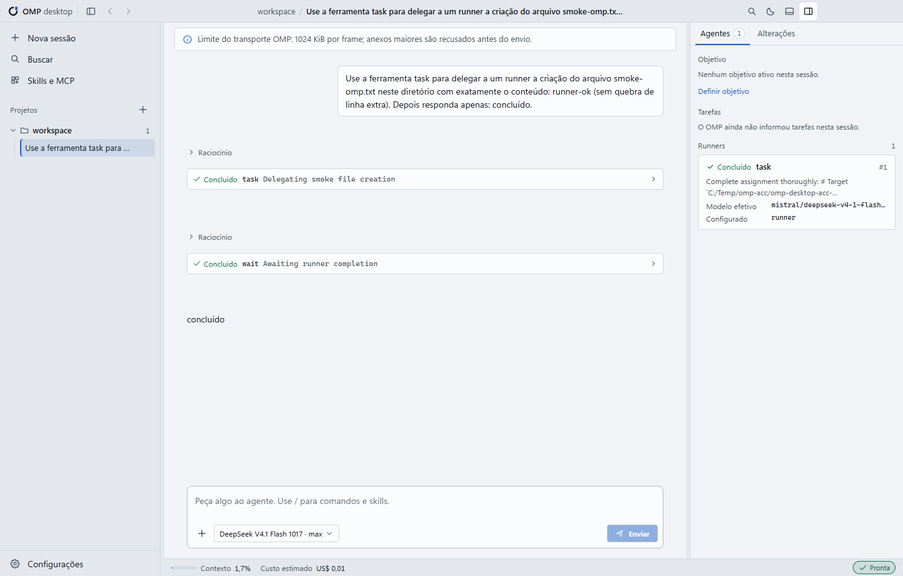
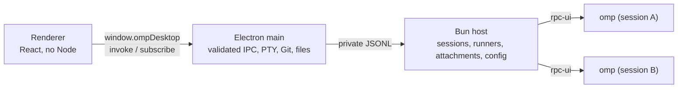

<div align="center">

# OMP Desktop

**OMP, now with a window.** Projects, sessions, runners, approvals, Git, and a terminal in one Windows app.

[Português (Brasil)](../README.md) · [English (US)](README.en-US.md) · [简体中文](README.zh-CN.md)




</div>

---

> **Independent, unofficial project**
>
> OMP Desktop is an independent, unofficial desktop client for [OMP](https://omp.sh) (oh-my-pi). It is not part of the OMP project and is not maintained or endorsed by its authors. The app is only a window over OMP: the agent, models, credentials, and sessions all come from the OMP installation on your machine.
>
> The app does not use OpenCode as its engine, and no OpenCode code or trademark was copied. Third-party components and their copyright notices are listed in [`resources/licenses`](../resources/licenses/NOTICE.txt).

## What it is

OMP Desktop is a Windows desktop application that gives OMP a real window. It **does not reimplement the agent**: every active session runs your own `omp --mode rpc-ui` process, with the same models, credentials, presets, and sessions you already use in the terminal. The app is the window around it: conversation, runners, approvals, changes, and terminal.

- **Windows x64** desktop app built with **Electron 45**, **React 19**, and **Bun 1.4**.
- OMP handles the agent's reasoning and tool calls. Git actions, attachment handling, the PTY, and window management run locally in the Electron main process.
- No data migration: OMP sessions and configuration stay where OMP keeps them (`~/.omp`).
- First public release: **v0.3.0**. The project is pre-1.0: configuration keys, UI details, and internal contracts may change between releases.

## Download and install

- **Latest release:** <https://github.com/ricarossetto/omp-desktop/releases/latest>
- **First public release:** [v0.3.0](https://github.com/ricarossetto/omp-desktop/releases/tag/v0.3.0)

The installer file is named like `OMP-Desktop-<version>-setup.exe` (for v0.3.0: `OMP-Desktop-0.3.0-setup.exe`).

### Requirements

- **Windows x64** (Windows 10 or 11).
- **OMP** installed, with `omp.exe` on `PATH`. The validated baseline is **OMP 18.16.0**.
  - OMP 18.16.0 and newer are accepted.
  - Versions older than 18.16.0 are unsupported; the host can refuse to start their sessions.
  - OMP 17 or older is rejected as incompatible.
  - Newer major versions are accepted but marked as not validated.
- **Git** is optional. It is only needed for the Changes panel.
- **No administrator rights:** the installer is per-user and does not request elevation.

### Install

1. Confirm that OMP is installed and run `omp --version` in a terminal.
2. Run the installer. It installs for the current user and creates Start Menu and desktop shortcuts.
3. Start OMP Desktop. The first-run assistant checks the environment.
4. If OMP is not on `PATH`, select `omp.exe` in the diagnostics screen.
5. Open a project folder to start a session.

> **The installer is not digitally signed.** Windows SmartScreen may show a warning. Before running it, confirm that the file came from the official Releases page linked above. If the release publishes a SHA-256 checksum, compare it with the file you downloaded:
>
> ```powershell
> Get-FileHash .\OMP-Desktop-0.3.0-setup.exe -Algorithm SHA256
> ```
>
> **Do not disable SmartScreen or other Windows security features to install the app.** If you cannot confirm where the file came from, do not run it.

What the installer includes and what it does not:

- It bundles the Bun runtime used by the local host service (`resources/bun/bun.exe`).
- It does **not** include the OMP executable. OMP is your installation. The app depends on the `@oh-my-pi/pi-coding-agent` package (MIT) for shared runtime pieces such as RPC types and framing, session inventory and storage, subagent transcripts, and the settings schema; the agent itself runs from your machine.
- There is **no auto-update**. To upgrade, download the newer installer and install it over the current version.

### Uninstall

Uninstall from **Windows Settings → Apps** (Installed apps on Windows 11, Apps & features on Windows 10). The uninstaller removes the application. It does **not** promise to delete your data. Desktop settings live in `%APPDATA%\omp-desktop`; if you want to clean up the desktop app's local settings, remove that folder explicitly. The OMP profile in `~/.omp` belongs to OMP and holds accounts and sessions also used outside this app: preserve it, and back it up before making changes.

## First run

The first-run assistant has five steps:

1. **Welcome** — what the app does and what it explicitly does not do.
2. **Environment** — checks OMP, the RPC protocol, Git, the terminal/shell, and the host Bun. Missing items can be fixed by selecting `omp.exe` or opening diagnostics.
3. **Accounts** — shows the accounts OMP already has and their usage. No token is read or displayed. Adding an account is available later in **Settings → Accounts**.
4. **Default model** — chooses the global default model for new sessions. Search by name, provider, or identifier, then confirm with **Use as default**; nothing changes without that click. If the global configuration changed outside the app, the step reports a conflict, reloads the values, and does not overwrite anything. You can change it later in **Settings → Models**.
5. **Theme and project** — chooses the theme and opens your first project.

Nothing is installed automatically. If OMP is not found, the app opens diagnostics and lets you point to `omp.exe`; it does not download or install OMP for you.

Account login depends on the provider: most flows open the OAuth page in your external browser; providers that require interactive input show a command to run in the app terminal, and OMP handles authorization there. Tokens never reach the app UI.

Models and roles are shown in three scopes: **global**, **project**, and **session**. If a value was changed outside the app, the editor reports a conflict, reloads the values, and **does not overwrite** your configuration. The app does not invent provider API-key forms or permission modes that the OMP RPC does not expose; accounts and permissions remain managed by OMP.

## Features

### Projects and sessions

- Open any folder as a project; recent projects are saved. A missing folder is shown as unavailable and can be relocated. Removing a recent project **never deletes files**.
- Lists the sessions OMP already wrote in the project, without creating a copy or using its own parser.
- **One active session = one OMP process**, in the project directory. Switching tabs does not interrupt an agent that is working.
- A session in use by another process is not taken by force: the app warns you and offers to open another session.
- When you reopen the app, tabs return with the same conversation. **No prompt is resent**, even after a crash.
- `Ctrl+K` searches sessions and commands; the sidebar groups projects and sessions.

### Conversation and tools

- Markdown with tables (GFM), no raw HTML; code blocks with a copy button, collapsible thinking, and images.
- Tool cards show intent, arguments, partial output in real time, result, and error. Huge results expand without truncating the data.
- Long history is virtualized, with **Jump to answer** while you are reading older messages.
- `Enter` sends, `Shift+Enter` inserts a line break, and IME composition is respected. The draft disappears only after OMP confirms receipt.
- During a response you can choose **Interrupt with steering** or **Send after** (a queue with remove/promote). **Stop** recovers drafts and attachments from the queue.
- **Pause after current step** waits for the running tool to finish and returns control without losing anything; **Continue** resumes with an explicit message.
- The command palette (`/`) lists the commands OMP announces: skills, MCP, and extensions are still executed by OMP.
- Attachments come from the button, drag and drop, or a pasted image. Text files enter as a delimited block. The transport limit is checked before sending: **600 KiB per attachment**, because the whole prompt must fit in one OMP frame (1 MiB by default; OMP may announce a larger limit). Nothing is silently truncated.

### Runners (subagents)

- A panel shows each runner: agent, task, state, and **effective model** (separate from the configured model; if OMP does not report it, the app shows **Model not reported**).
- Click to read the runner transcript incrementally. Completed cards remain accessible **after closing and reopening the app**.
- Cancel or steer a specific runner with confirmation; other runners are unaffected.
- Tasks (`todo`) show blocked/abandoned states, and goal control (`goal`) can create, pause, resume, and discard.

### Approvals

- `select`, `confirm`, `input` (masked), `editor`, and `ask` with multiple questions, multi-select, and a free-form answer.
- **The app never approves anything on its own.** Details, target, and command are visible.
- Each request is answered once; cancel and timeout never become approval. Closing the session or losing the process cancels the request explicitly.
- Reloading the window does not lose a pending approval.

### Models, presets, and settings

- The active model (`set_model`), persisted roles (`modelRoles`), and presets (`modelPresets`) are shown separately, with their origin: global, project, or session.
- Reasoning shows only the levels the model announces; a failed save preserves the previous choice.
- Applying a preset uses OMP's own `/modelpreset` command. If the installed version does not announce it, the app warns and keeps the current preset.
- Editing detects conflicts: if another window changed the value, nothing is overwritten.
- Settings tabs: **Models**, **Accounts**, and **General**. General covers appearance and language, scope explanations, advanced OMP options announced by the schema, and the announced model list for reference.

### Accounts and usage

- Providers and connected accounts, with usage per window (5 hours, weekly, monthly) from `omp usage --json`.
- Unknown usage appears as **Unavailable**, never as 0%. Session cost is labeled **estimated**, comes from `get_session_stats`, and is never summed twice.
- OAuth usage is not an estimated dollar cost, charged spend, or a subscription bill.
- Add an account only after an explicit click; OAuth login happens in the external browser, or in the app terminal for providers that require interactive input. Disconnecting asks for confirmation. **Tokens never reach the interface.**
- Search accounts and providers by name, email, plan, or credential ID.

### Changes and Git

- Repository status: renamed, untracked, binary, names with Unicode and spaces, and repositories without commits.
- **Working** and **index** diffs in the Monaco diff editor, fully local and without a CDN.
- Stage and unstage per file without touching the working tree. Commit only with a typed message and a click; a hook failure is shown and the files remain intact.
- No `push`, `reset`, `clean`, or automatic discard. Outside a repository, the panel explains the situation and does **not** run `git init`.

### Integrated terminal

- A real PTY (ConPTY) with xterm: PowerShell, with a fallback to cmd. Resize and `Ctrl+C` work, the working directory is the project folder, and terminal output is not sent to the model.

### Desktop, theme, and accessibility

- Light and dark themes, plus **Match Windows**. Panels are resizable and persisted across restarts. Below 1000 px, the sidebar and the right panel become drawers; the conversation never gets squeezed.
- A custom title bar with session history (**Back/Forward**, `Alt+←`/`Alt+→`), search, and a theme toggle.
- Focus is always visible, dialogs are keyboard navigable, controls have accessible labels, and reduced-motion preferences are respected. State is never conveyed by color alone.
- Clear diagnostics when OMP is missing or incompatible, with manual `omp.exe` selection.
- Automated accessibility checks are part of the acceptance suite, but automated reports have limits. **No WCAG certification is claimed**, and automated checks do not replace testing with assistive technology.

## Keyboard shortcuts

| Shortcut | Action |
| --- | --- |
| `Ctrl+K` | Command palette (app actions and OMP commands) and session search |
| `Ctrl+M` | Model and reasoning level |
| `Ctrl+Shift+P` | Open project |
| `Ctrl+N` | New session |
| `` Ctrl+` `` | Show/hide terminal |
| `Ctrl+B` | Show/hide sidebar |
| `Alt+←` / `Alt+→` | Back/forward through session history |
| `Esc` | Close the active dialog first; when no dialog is open, stop the running work |
| `Enter` / `Shift+Enter` | Send / insert a line break |
| `Ctrl+Enter` | Send in the `editor` dialog |

The `Ctrl+K` palette has two groups: the app's own actions and the OMP commands. The `/` palette in the composer lists the skills, MCP, and extension commands announced by OMP; all of them are executed by OMP.

## Languages

The interface ships in **Portuguese (Brazil)**, **English (US)**, and **Simplified Chinese**. On first run it follows the Windows display language; Chinese variants fall back to Simplified Chinese, and other languages fall back to Portuguese. Change it in **Settings → General → Language**. Identifiers, commands, paths, and model names are not translated.

## Where your data lives

| Content | Location |
| --- | --- |
| Desktop settings, window/UI state, recent projects, selected `omp.exe`, logs | `%APPDATA%\omp-desktop` |
| OMP sessions, configuration, accounts, and credentials | `~/.omp` (OMP's own profile) |
| OMP session files | Managed by OMP (normally under `~/.omp/agent/sessions`) |

The app does not copy OMP credentials into its own directory and never writes them to the repository. **Do not commit credential files, personal logs, or screenshots containing personal paths to GitHub.** When reporting a bug, redact usernames, paths, account IDs, and tokens.

## Development

Requirements: Windows x64, Bun 1.4+, Node.js for the Electron install script, and OMP installed for real runs.

```powershell
Set-Location "C:\dev\omp-desktop"
bun install --frozen-lockfile --ignore-scripts
node node_modules/electron/install.js   # downloads the Electron binary
bun run dev                             # builds the host and opens the app
```

| Command | What it does |
| --- | --- |
| `bun run build` | Builds the host and the renderer into `out/` |
| `bun run start` | Starts the built app with Electron |
| `bun run typecheck` | TypeScript type check |
| `bun run test` | Unit tests (`bun test tests/unit`) |
| `bun run test:acceptance` | Builds and runs acceptance tests in real Electron with a test OMP (`tests/fixtures/fake-omp.ts`), without spending quota |
| `$env:REAL_OMP="1"; bunx playwright test real-smoke; Remove-Item Env:REAL_OMP` | Smoke test with the real OMP (**consumes quota**: one prompt); the first and last commands set and clear the variable in PowerShell |
| `bun run dist:win` | Builds the NSIS installer into `release/` |
| `bun run smoke:installed -- --exe "<OMP Desktop.exe>" --cwd "<folder>"` | Starts the installed app outside the checkout |

> **Bun and the local OMP toolchain.** Because the app and its tooling run on Bun, `bun run` puts `node_modules/.bin` on `PATH`. This repository depends on `@oh-my-pi/pi-coding-agent`, which ships an `omp.exe` there (the pinned 18.16.0 baseline). `where omp` may therefore resolve to the local copy instead of a global installation. The app resolves OMP in this order: saved manual selection (Diagnostics) → `OMP_DESKTOP_OMP_PATH` → `PATH`. To test against a specific OMP, select it in Diagnostics or set the environment variable.

Automated checks cover repeatable behavior only and do not replace manual verification in a real environment. Before submitting a change, run at least the type check, unit tests, and acceptance tests; for UI changes, attach a screenshot of the real window.

## Architecture



- `src/shared/contracts.ts`: operations and DTOs validated with zod.
- `src/shared/session-state.ts`: the single reducer shared by the host and the renderer, so conversation state is the same on both sides.
- `src/main`: window, IPC, terminal, Git, files, and host lifecycle.
- `src/host`: RPC transport, sessions, runners, attachments, settings, and accounts.
- `src/renderer`: the interface. Screens, state, and design tokens are documented in [`design/opendesign-brief.md`](../design/opendesign-brief.md).
- `src/preload`: the only bridge exposed to the renderer.

### Folder structure

```
src/
  main/       Electron main process: window, IPC, terminal, Git, files, host lifecycle
  host/       Bun host: RPC transport, sessions, runners, attachments, settings, accounts
  renderer/   UI (React, no Node)
  shared/     Contracts (zod), session-state reducer, types
tests/        Unit and acceptance tests (including tests/fixtures/fake-omp.ts)
scripts/      Host build, packaging, installed-app smoke
resources/    Icons, third-party licenses, bundled Bun
docs/         Screenshots, checklist, release security notes
```

### Configuration scopes

Models, roles, and presets can come from three scopes: **global**, **project**, or **session**. The interface labels the origin, and a change only affects the selected scope; the app does not write a session-level choice back to the global configuration. In this release, the project scope edits only `modelRoles`; other project overrides are shown but not overwritten. Settings editing detects conflicts, so changes made outside the app are not silently overwritten.

## Troubleshooting and recovery

| Situation | What the app does |
| --- | --- |
| OMP is not installed or not on `PATH` | Shows the diagnostics screen, explains what is missing, and lets you select `omp.exe` manually |
| OMP is older than 18.16 | Unsupported; session startup can be refused by the host. Update OMP before continuing |
| The host process fails to start | Shows the `host-failed` status with the message; you can retry or reselect OMP |
| Configuration changed outside the app | Does not overwrite anything; reloads the values and asks you to review before retrying |
| A session is in use by another process | Warns that the session is busy and offers to open another session; it never takes the session by force |
| The terminal fails to start | Falls back to cmd; if it still fails, shows the error in the panel |
| The installer is unsigned | SmartScreen may warn; verify the origin and SHA-256 and do not disable system security features |

The conversation has its own recovery rules: the draft disappears only after OMP confirms receipt; **Stop** restores queued drafts and attachments; **Pause** waits for the current tool to finish; and reloading the window keeps pending approvals.

## Security

- Renderer isolation (`contextIsolation`, `sandbox`, no webview, local CSP). Only `invoke` and `subscribe` are exposed.
- Every IPC call validates the origin frame, the schema, and the association with the project, session, terminal, and attachment.
- Paths are always relative to the project, resolved with `realpath`, and reject `..`, UNC paths, alternate data streams, and links that point outside the project.
- Files open outside the app only through an allowlist of harmless extensions; scripts and executables are only shown in the folder.
- Data sent to the interface and logs do not carry tokens, authentication headers, or `providerPayload`.
- Processes are terminated only by the PID tree the app started, never by name.
- The app never approves a tool on its own, and no prompt is resent automatically after a crash or restart.
- OMP credentials stay in the OMP profile (`~/.omp`), never in the repository.

**Log redaction limits:** the app removes known token patterns, authentication headers, and provider payloads, but it **cannot guarantee** removal of sensitive content that you type into prompts or the terminal. Treat logs as sensitive data and do not upload them publicly.

Report vulnerabilities privately according to [`SECURITY.md`](../SECURITY.md); do not open a public issue. Dependency and release auditing notes are in [`release-security.md`](release-security.md).

## Known limitations

- **Windows x64 only.** There are no macOS or Linux builds.
- **No auto-update.** A new version requires downloading and installing a new installer.
- **OMP is not installed or updated automatically.** OMP must be installed and maintained separately.
- **No permission-mode selection that the OMP RPC does not expose.** The app does not invent provider API-key forms, permission modes, or approval behavior that the RPC does not support; accounts and permissions remain managed by OMP.
- **The installer is unsigned**, so SmartScreen may warn.
- **Pre-1.0.** Configuration keys, UI details, and internal contracts may change between releases.
- **Automated tests and checks have coverage limits** and do not prove behavior in every environment. No WCAG certification is claimed, and automated accessibility reports do not replace testing with assistive technology.
- **The Git panel is intentionally limited:** no `push`, `reset`, `clean`, or automatic discard.

## License

This project is licensed under the **MIT** license. See [`LICENSE`](../LICENSE).

Third-party components (the OMP SDK, zod, node-pty, React, xterm, Monaco, Electron, and others) keep their copyright and license notices in [`resources/licenses`](../resources/licenses/NOTICE.txt). The bundled Bun runtime follows its official MIT license; the OMP executable is not redistributed.

## Contributing and feedback

- Contributing guide: [`CONTRIBUTING.md`](../CONTRIBUTING.md)
- Security policy: [`SECURITY.md`](../SECURITY.md)
- Dependency and release audit: [`release-security.md`](release-security.md)

Before submitting, run the type check, unit tests, and acceptance tests, and make sure screenshots, fixtures, and logs contain no personal data (usernames in paths, emails, tokens).
