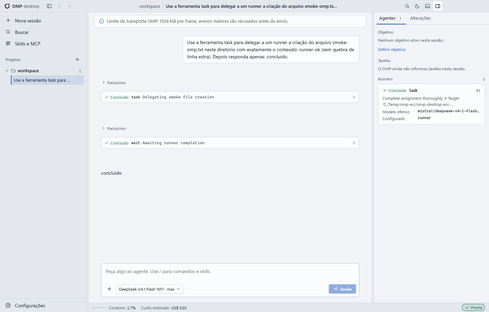
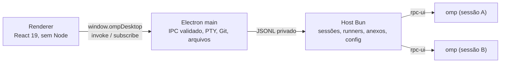

<div align="center">

# OMP Desktop

**O OMP com janela de verdade.** Projetos, sessões, runners, aprovações, Git e terminal em um aplicativo Windows e Linux.


[Português (Brasil)](README.pt-BR.md) | [English (US)](../README.md) | [简体中文](README.zh-CN.md)



</div>

---

> **Projeto independente e não oficial.** O OMP Desktop não é afiliado, mantido nem endossado pelos autores do oh-my-pi/OMP. É um cliente desktop que conversa com o OMP instalado na sua máquina. O agente, os modelos, as credenciais e as sessões continuam sendo do OMP.

## Sumário

- [O que é](#o-que-é)
- [O que ele não faz](#o-que-ele-não-faz)
- [Estado do release](#estado-do-release)
- [Primeiro uso](#primeiro-uso)
- [Instalação](#instalação)
- [Funcionalidades](#funcionalidades)
- [Atalhos](#atalhos)
- [Idiomas](#idiomas)
- [Onde ficam os dados](#onde-ficam-os-dados)
- [Desenvolvimento](#desenvolvimento)
- [Arquitetura](#arquitetura)
- [Segurança e privacidade](#segurança-e-privacidade)
- [Recuperação de erros](#recuperação-de-erros)
- [Limitações conhecidas](#limitações-conhecidas)
- [Contribuição](#contribuição)
- [Licença e componentes de terceiros](#licença-e-componentes-de-terceiros)

## O que é

O OMP Desktop é uma interface gráfica para Windows e Linux para o [OMP](https://omp.sh) (oh-my-pi). Ele **não reimplementa o agente**: cada sessão ativa inicia o próprio `omp --mode rpc-ui`, no diretório do projeto, com o mesmo modelo, as mesmas credenciais, os mesmos presets e as mesmas sessões que você já usa no terminal. O aplicativo conversa com esse processo por RPC e mostra a conversa, os runners, as aprovações e as alterações.

Na prática, o app é uma janela: o trabalho continua sendo feito pelo OMP que está instalado na sua máquina. O desktop cuida da interface, do ciclo de vida dos processos, do terminal, do painel Git e da organização dos projetos — não do raciocínio do agente.

### O que ele não faz

- **Não é outro agente.** Não existe um modelo embutido nem uma segunda implementação do OMP.
- **Não instala o OMP em silêncio.** Se o OMP estiver ausente na primeira execução, o assistente oferece a instalação oficial depois de um clique explícito em **Install OMP**; nada é instalado ao montar o componente. Também é possível apontar um executável do OMP existente (`omp.exe` no Windows, `omp` no Linux) a qualquer momento.
- **Não aprova nada sozinho.** Comandos, alvos e detalhes ficam visíveis antes de qualquer confirmação.
- **Não reenvia prompts.** Ao reabrir o app ou depois de uma queda, as abas voltam com o histórico, mas nada é enviado de novo sem uma ação sua.
- **Não é um fork do OMP.** O projeto é um cliente desktop independente.

## Estado do release

A versão atual é **0.5.0**. O release **v0.5.0** é **Windows x64** e traz `OMP-Desktop-0.5.0-setup.exe`. Os pacotes Linux x86_64 continuam no [release v0.3.1](https://github.com/ricarossetto/omp-desktop/releases/tag/v0.3.1); o código 0.5.0 ainda gera esses pacotes. O release público anterior para Windows foi o [v0.3.1](https://github.com/ricarossetto/omp-desktop/releases/tag/v0.3.1).

O instalador Windows é por usuário, sem necessidade de administrador e **sem assinatura digital**. Os pacotes Linux (v0.3.1) também não são assinados. Não há atualização automática em nenhuma das plataformas: para atualizar, baixe ou gere o novo pacote e instale por cima. A v0.3.0 começou o ciclo público; a v0.5.0 é o release atual, ainda pré-1.0.

## Primeiro uso

Na primeira execução, um assistente em cinco passos prepara o ambiente:

1. **Boas-vindas** — explica que o app usa o seu OMP, que nada é aprovado sozinho e que as abas voltam sem reenviar prompts. Também avisa que o instalador não é assinado.
2. **Ambiente** — confere OMP, protocolo RPC, Bun do host, Git e terminal/shell. Se o OMP não for encontrado, a etapa oferece **Install OMP**: nada é executado sem um clique explícito em **Install OMP**, a instalação informa o progresso (resolving, downloading, verifying, activating) e termina em sucesso ou erro acionável e, ao concluir, o app detecta o executável real e atualiza o diagnóstico sem reiniciar, reabrir o fluxo ou perder o rascunho e o idioma. Se a instalação falhar, **Selecionar executável do OMP** continua disponível. A etapa também mostra ações opcionais de **Git** e **Node.js LTS**; nenhuma é necessária para continuar. Os métodos estão em [Instalar o OMP pelo aplicativo](#instalar-o-omp-pelo-aplicativo) e [Instalar ferramentas opcionais](#instalar-ferramentas-opcionais).
3. **Contas** — mostra o uso que o OMP já conhece, sem exibir tokens. Para adicionar outra conta, abra um projeto e use **Configurações → Contas**; o login só começa com um clique seu.
4. **Modelo padrão** — lista os modelos anunciados pelo OMP e permite escolher o padrão global. Se a configuração mudar fora do aplicativo, nada é sobrescrito: os valores são recarregados e você escolhe de novo.
5. **Tema e projeto** — escolhe tema escuro, claro ou seguir o tema do sistema, mostra os atalhos e permite abrir a primeira pasta. Concluir sem abrir uma pasta apenas fecha a introdução; nenhum projeto é criado.

Depois disso, abra uma pasta, crie uma sessão e converse. As configurações ficam na paleta de comandos (`Ctrl+K`) e no ícone de engrenagem.

## Instalação

| Sistema | Pacote | Estado |
| --- | --- | --- |
| Windows 10/11 x64 | `OMP-Desktop-0.5.0-setup.exe` (NSIS, x64) | incluído na v0.5.0 |
| Debian 12/13, Ubuntu 24.04/26.04 x86_64 | `OMP-Desktop-0.3.1-linux-amd64.deb` | release Linux mais recente (v0.3.1) |
| Linux x86_64 (TAR.GZ) | `OMP-Desktop-0.3.1-linux-x64.tar.gz` | release Linux mais recente (v0.3.1) |
| Arch Linux x86_64 | `omp-desktop-0.3.1-1-x86_64.pkg.tar.zst` (PKGBUILD) | release Linux mais recente (v0.3.1) |

O release **v0.5.0** publica o instalador Windows e um `SHA256SUMS` para ele. O release **v0.3.1** mantém o `SHA256SUMS` global que cobre os quatro artefatos 0.3.1.

**Suporte de versão do OMP:** A baseline validada é 18.16.0, e o instalador assistido fixa exatamente 18.16.0. O host aceita OMP com major 18 ou maior; OMP 17 ou anterior é rejeitado como incompatível. Versões mais novas que a série 18.x são aceitas, mas marcadas como não validadas. A mesma regra vale para Windows e Linux.

O aplicativo **não inclui o executável do OMP**. Ele inclui o runtime Bun usado pelo serviço local e a dependência `@oh-my-pi/pi-coding-agent` (MIT), que é uma biblioteca do host — o agente continua sendo o executável do OMP da sua instalação ou da instalação assistida. O Git e o Node.js LTS não são incluídos; ambos são opcionais. No Windows o app pode instalar os dois; no Linux o app pode instalar o Node.js e mostra o comando do Git para o seu gerenciador de pacotes. Sem Git, o painel Alterações explica a ausência e não simula um repositório; o restante do app continua funcionando.

### Windows

| Item | Detalhe |
| --- | --- |
| Sistema | Windows x64 (Windows 10 ou 11) |
| Instalador | `OMP-Desktop-0.5.0-setup.exe` (NSIS, x64); o instalador anterior v0.3.1 mantém o nome 0.3.1 |
| Escopo | por usuário; não pede administrador |
| Assinatura | não assinado; o SmartScreen pode avisar |
| Bun | embutido em `resources/bun/bun.exe` |
| OMP | não incluído; a primeira execução pode instalar o binário oficial fixado (18.16.0) após clique explícito, ou selecione um `omp.exe` existente |
| Git | opcional; necessário apenas para o painel Alterações; o app pode instalar o MinGit oficial sob demanda |
| Node.js | opcional; necessário apenas para projetos/MCP e o npm oficial; o app pode instalar o Node.js LTS atual sob demanda |
| Atualização | manual; não há auto-update |

1. Baixe o instalador no [release v0.5.0](https://github.com/ricarossetto/omp-desktop/releases/tag/v0.5.0) (tag `v0.5.0`, `OMP-Desktop-0.5.0-setup.exe`). O instalador anterior v0.3.1 mantém o nome 0.3.1.
2. Se o release publicar um SHA-256, confira o arquivo antes de executar (veja abaixo).
3. Execute o instalador. Ele instala na pasta do usuário e não pede elevação.
4. Abra o OMP Desktop. O assistente confere o ambiente; se o OMP não for encontrado, escolha **Install OMP**, ou aponte um `omp.exe` existente.
5. Abra uma pasta de projeto e crie a primeira sessão.

### Linux (x86_64)

Os pacotes Linux são gerados a partir deste código e estão incluídos no release **v0.3.1** junto com o Windows. O v0.3.0 era somente Windows. O release **v0.5.0** é somente Windows; os pacotes Linux continuam na v0.3.1 até a publicação de um build Linux. O projeto não publica pacote AUR, PPA, AppImage nem canal de atualização automática. Os alvos planejados são Debian 12 e 13, Ubuntu 24.04 e 26.04 e Arch Linux atual, todos x86_64 com glibc; ARM e macOS ficam fora do escopo.

| Item | Detalhe |
| --- | --- |
| Sistema | Linux x86_64 (Debian 12/13, Ubuntu 24.04/26.04, Arch) |
| Pacotes | `OMP-Desktop-0.3.1-linux-amd64.deb`; `OMP-Desktop-0.3.1-linux-x64.tar.gz`; `omp-desktop-0.3.1-1-x86_64.pkg.tar.zst` gerado a partir de `packaging/arch/PKGBUILD` |
| Escopo | instalação de sistema em `/opt`; o app roda como seu usuário |
| Assinatura | não assinado; confira `release/SHA256SUMS` |
| Bun | embutido em `resources/bun/bun` (Bun 1.4.4 baseline oficial, x86_64, modo 0755) |
| OMP | não incluído; a primeira execução pode instalar o binário oficial Linux x86_64 fixado (18.16.0) após clique explícito em `$HOME/.local/bin/omp` (ou `PI_INSTALL_DIR`), ou selecione um `omp` existente |
| Git | opcional; somente nativo. O app nunca executa `sudo`, `apt` ou `pacman`; mostra o comando da sua distribuição |
| Node.js | opcional; o app pode instalar o Node.js LTS oficial `linux-x64` atual em `$XDG_DATA_HOME/omp-desktop/tools/node` (padrão `~/.local/share/omp-desktop/tools/node`) |
| Atualização | manual; não há auto-update |

Pré-requisitos de build: Linux x86_64 com glibc, Bun 1.4.4, Node.js para o passo de download do Electron e as ferramentas de empacotamento (`dpkg-deb` para o `.deb`; `base-devel`/`makepkg` no Arch). `libatomic.so.1` (`libatomic1` no Debian/Ubuntu; `libatomic`, fornecido por `gcc-libs`, no Arch) é exigido pelo binário oficial do Node.js e é dependência de runtime dos dois pacotes.

```bash
git clone https://github.com/ricarossetto/omp-desktop.git
cd omp-desktop
bun install --frozen-lockfile
node node_modules/electron/install.js   # somente se os scripts de ciclo de vida foram pulados
bun run build
bun run dist:linux                      # .deb + .tar.gz (+ pacote Arch quando makepkg existe)
```

`bun scripts/dist-linux.ts --no-arch` gera apenas o `.deb` e o `.tar.gz`; `--clean` remove intermediários. As saídas ficam em `release/` com `SHA256SUMS`. O build baixa uma vez o ZIP oficial do Bun 1.4.4 baseline, confere o SHA-256 e o binário extraído e grava `resources/bun/bun` com modo 0755.

Instale o `.deb` no Debian ou Ubuntu:

```bash
sudo apt install ./release/OMP-Desktop-0.3.1-linux-amd64.deb
```

O `apt` resolve as dependências do Electron declaradas pelo pacote (incluindo `libgtk-3-0`/`libgtk-3-0t64`, `libasound2`/`libasound2t64` e `libatomic1`). O app é instalado em `/opt/omp-desktop`, com `/usr/bin/omp-desktop`, entrada `.desktop` em `/usr/share/applications` e ícones hicolor. No Ubuntu 24.04 ou mais novo o pacote também instala um perfil AppArmor; em sistemas sem user namespaces, o `chrome-sandbox` recebe modo 4755. O app nunca roda com `--no-sandbox`. O Git aparece apenas como `Suggests` e não é instalado por padrão.

Compile e instale no Arch:

```bash
cd packaging/arch
makepkg -f
sudo pacman -U omp-desktop-0.3.1-1-x86_64.pkg.tar.zst
```

O PKGBUILD usa o `OMP-Desktop-0.3.1-linux-x64.tar.gz` local gerado pelo `dist:linux` e instala em `/opt/omp-desktop`, com `/usr/bin/omp-desktop`, ícones, licenças e `chrome-sandbox` em modo 4755. Ele **não** trata um hash calculado do próprio artefato como verificação: lê um SHA-256 confiável de `OMP_DESKTOP_ARCHIVE_SHA256`, ou de `release/SHA256SUMS`/`<archive>.sha256`, e aborta se não houver nenhum. Não há `SKIP` nem URL de release inexistente. `makepkg` não pode rodar como root. Git e Node.js são apenas `optdepends`.

Em um checkout do código, `bun run dist:linux` grava `release/OMP-Desktop-0.3.1-linux-x64.tar.gz` e `release/SHA256SUMS`; `cd packaging/arch && makepkg -f` usa os dois.

O diretório final de entrega é plano: o TAR e o `SHA256SUMS` ficam na raiz, com `packaging/arch/PKGBUILD` abaixo e **sem pasta `release/`**. A partir de `packaging/arch`, passe o artefato e o hash confiável explicitamente:

```bash
cd packaging/arch
OMP_DESKTOP_ARCHIVE=../../OMP-Desktop-0.3.1-linux-x64.tar.gz \
OMP_DESKTOP_ARCHIVE_SHA256="$(grep ' OMP-Desktop-0.3.1-linux-x64.tar.gz$' ../../SHA256SUMS | cut -d' ' -f1)" \
makepkg -f
```

O hash vem do `SHA256SUMS` entregue; não o substitua por um hash calculado do próprio TAR. `OMP_DESKTOP_ARCHIVE` sem `OMP_DESKTOP_ARCHIVE_SHA256` é rejeitado.

Desinstalação:

```bash
sudo apt remove omp-desktop        # Debian/Ubuntu
sudo pacman -R omp-desktop         # Arch
```

Remover o pacote não apaga `$XDG_CONFIG_HOME/omp-desktop` (padrão `~/.config/omp-desktop`), a pasta gerenciada do Node.js nem `~/.omp`.

#### Compatibilidade Linux

| Distribuição | Versão | Estado |
| --- | --- | --- |
| Debian | 12 | testado — instalação, inicialização, PTY e remoção |
| Debian | 13 | testado — instalação, inicialização, PTY e remoção |
| Ubuntu | 24.04 | testado — instalação, inicialização, PTY e remoção |
| Ubuntu | 26.04 | testado — instalação, inicialização, PTY e remoção |
| Arch Linux | atual | testado — instalação, inicialização, PTY e remoção |

Debian 12/13, Ubuntu 24.04/26.04 e Arch Linux atual passaram nas verificações reais dos pacotes (instalação, inicialização, PTY e remoção) em contêineres Docker não-root com Xvfb; o sandbox permaneceu habilitado. É validação de pacote/runtime em kernel compartilhado, não uma declaração de cobertura nativa em VM completa.

### Instalar o OMP pelo aplicativo

Se o OMP estiver ausente, o assistente da primeira execução e a tela de diagnóstico oferecem **Install OMP**. Depois de um clique explícito em **Install OMP**, o app:

- resolve o binário **18.16.0** pelo mesmo serviço oficial de builds usado pelos instaladores do OMP (`build.stencil.so`), para a plataforma e a arquitetura atuais (`windows-x86_64` no Windows x64, `linux-x86_64` no Linux x64);
- baixa por HTTPS para `%LOCALAPPDATA%\omp\omp.exe` no Windows e para `$HOME/.local/bin/omp` no Linux, respeitando `PI_INSTALL_DIR` como o instalador oficial, sem privilégios de administrador; no Linux o binário recebe modo 0755;
- confere o SHA-256 publicado pelo serviço oficial e executa `omp.exe --version` (Windows) ou `omp --version` (Linux), exigindo a versão fixada antes de usar o arquivo;
- nunca sobrescreve um executável do OMP existente: um arquivo compatível é adotado e um incompatível é reportado como conflito, mantendo a seleção manual disponível.

Na primeira execução sem OMP, o app abre o Diagnóstico diretamente; a etapa Ambiente do onboarding mostra a mesma ação. O app não altera o PATH persistente do usuário (nem o registro do Windows): guarda o caminho absoluto no próprio estado de runtime e adiciona a pasta apenas ao PATH dos seus próprios processos (host e terminal). Ele não toca em `~/.omp`. Cliques concorrentes compartilham uma única instalação, e fechar o app durante a instalação aborta o download e remove os arquivos temporários.

O Bun embutido é apenas o runtime do host local; o binário do OMP é autônomo, então não é necessário instalar um Bun global. O renderer não pode fornecer URL nem comando: host de download, nome do arquivo, versão e argumentos são fixos no processo principal. Ao concluir, o app aplica o caminho detectado e atualiza onboarding/diagnóstico sem reiniciar nem perder o rascunho ou o idioma. Erros de rede, checksum, versão, gravação, ativação e cancelamento são exibidos com opção de tentar de novo (falha de ativação mantém o binário instalado), **Check again** refaz a verificação do ambiente, e **Selecionar executável do OMP** continua disponível.

Também é possível instalar o OMP manualmente seguindo as instruções oficiais em [omp.sh](https://omp.sh) e escolher **Selecionar executável do OMP**. Os comandos oficiais são `irm https://omp.sh/install.ps1 | iex` no PowerShell do Windows e `curl -fsSL https://omp.sh/install | sh` em um terminal Linux; no Linux o script instala `omp` em `$HOME/.local/bin` por padrão. Um Bun global não é necessário para o binário autônomo.

### Instalar ferramentas opcionais

Git e Node.js LTS são opcionais. O app, o OMP e o onboarding funcionam sem qualquer um deles; o Bun já vem incluído e o OMP não exige Node.js do sistema. A etapa Ambiente, o Diagnóstico e **Configurações → Geral** mostram a seção **Ferramentas de desenvolvimento opcionais** com o estado de Git e Node.js LTS. No Windows, **Instalar Git** ou **Instalar Node.js LTS** mostra uma confirmação **Antes de instalar …** e o download só começa depois de **Baixar e instalar**. No Linux, **Instalar Node.js LTS** usa a mesma confirmação, enquanto **Instalar Git** mostra o comando do gerenciador de pacotes em vez de baixar qualquer coisa.

**Git (painel Alterações, Windows).** O app instala o ZIP oficial do Git for Windows [MinGit](https://gitforwindows.org/mingit.html) **2.56.0.windows.4** (a distribuição que o Git for Windows documenta para embutir) em `%LOCALAPPDATA%\omp-desktop\tools\git`, sem instalador, privilégios de administrador, winget ou MSI. Confere o SHA-256 publicado, extrai o ZIP com segurança e executa `git.exe --version` antes de usar. O app adiciona `...\tools\git\cmd` apenas ao PATH dos próprios processos. Alternativa manual: [git-scm.com/download/win](https://git-scm.com/download/win).

**Node.js LTS (projetos/MCP, Windows).** O app instala o **Node.js LTS atual resolvido em [nodejs.org](https://nodejs.org) no momento da instalação** (v26.13.0 no release) a partir do ZIP oficial do Windows em `%LOCALAPPDATA%\omp-desktop\tools\node`, sem instalador ou privilégios de administrador, incluindo o npm e o npx oficiais. Confere o SHA-256 do `SHASUMS256.txt` oficial, extrai com segurança e sonda o executável antes de usar. O app adiciona essa pasta apenas ao PATH dos próprios processos. Ele não instala dependências de projetos ou MCP; o npm fica disponível para você executá-las. Alternativa manual: [nodejs.org/en/download](https://nodejs.org/en/download).

**Git (painel Alterações, Linux).** O Git é nativo no Linux. O app nunca baixa MinGit, nunca executa `sudo`, `apt` ou `pacman` e nunca pede sua senha. **Instalar Git** mostra o comando fixo da sua distribuição — `sudo apt install git` no Debian/Ubuntu ou `sudo pacman -S git` no Arch — para você rodar no seu próprio terminal; **Verificar novamente** refaz a sondagem. Referência manual: [git-scm.com/download/linux](https://git-scm.com/download/linux).

**Node.js LTS (projetos/MCP, Linux).** O app instala o **Node.js LTS atual resolvido em [nodejs.org](https://nodejs.org) no momento da instalação** (v26.13.0 no release) a partir do TAR.GZ oficial `linux-x64` em `$XDG_DATA_HOME/omp-desktop/tools/node` (padrão `~/.local/share/omp-desktop/tools/node`), incluindo o npm e o npx oficiais. Confere o SHA-256 do `SHASUMS256.txt` oficial, extrai o TAR.GZ com um leitor seguro que aceita apenas symlinks relativos e sonda o executável antes de usar. Somente `<tools>/node/bin` é adicionado ao PATH dos próprios processos. O binário oficial do Node exige `libatomic.so.1`: no Debian/Ubuntu instale `libatomic1`; no Arch instale `libatomic` (fornecido por `gcc-libs`). Se a biblioteca faltar, o app informa o comando em vez de ativar uma ferramenta quebrada. Alternativa manual: [nodejs.org/en/download](https://nodejs.org/en/download).

No Windows, as duas instalações são por usuário e não alteram o PATH persistente do usuário ou do sistema, o registro nem uma instalação global existente de Git/Node.js. No Linux, a pasta gerenciada do Node.js é por usuário no diretório XDG de dados e nenhum pacote do sistema é alterado; o Git nunca é instalado pelo app. Nas duas plataformas, uma ferramenta global compatível no PATH é detectada e adotada como está; uma pasta gerenciada incompatível ou parcial é reportada, não sobrescrita. Novos terminais e processos host/OMP recém-iniciados veem as ferramentas; agentes e terminais em execução não são reiniciados nem interrompidos, e o próximo início do serviço local também as encontra. As instalações informam o progresso (resolving, downloading, verifying, extracting, activating) e terminam em sucesso ou erro acionável com **Tentar novamente**; **Verificar novamente** refaz a sondagem. Após o sucesso, a linha mostra a versão e o local instalados. Cliques concorrentes compartilham uma única instalação por ferramenta, e fechar o app aborta o download e limpa os arquivos temporários.

O renderer não pode fornecer URL, versão, comando nem pasta: fontes, versões, destinos e argumentos são fixos no processo principal. **Cancelar** aborta o download e deixa a instalação existente intacta. Também é possível instalar Git ou Node.js manualmente pelas páginas oficiais e usar **Verificar novamente**.

### Verificação do instalador

**Windows.** O instalador não é assinado digitalmente. O Windows pode exibir um aviso do SmartScreen; isso é esperado nesta versão.

- **Não desative** o SmartScreen, o antivírus ou a política de execução do Windows para instalar. Se o aviso impedir, verifique a origem e o hash; não contorne a proteção.
- Baixe apenas do repositório oficial e confira se o arquivo veio do release esperado.
- Se o release publicar um SHA-256, compare com o resultado de:

```powershell
Get-FileHash .\OMP-Desktop-0.5.0-setup.exe -Algorithm SHA256
```

O instalador anterior v0.3.1 mantém o nome 0.3.1. Se o hash não corresponder, não execute o arquivo.

**Linux.** O `.deb` e o pacote do Arch não são assinados. Gere-os a partir deste código ou obtenha-os de uma origem confiável e confira `release/SHA256SUMS` antes de instalar:

```bash
cd release
sha256sum -c SHA256SUMS
```

Não desative o AppArmor, o sandbox nem a verificação de pacotes da sua distribuição para instalar o app. Se o hash não bater, não instale o pacote.

### Desinstalação

**Windows:** desinstalar remove o aplicativo. Os dados em `%APPDATA%\omp-desktop` e o perfil `~/.omp` **não são apagados automaticamente**; se quiser removê-los, faça isso manualmente. O instalador não promete limpar tudo.

**Linux:** `sudo apt remove omp-desktop` no Debian/Ubuntu ou `sudo pacman -R omp-desktop` no Arch remove os arquivos do aplicativo. `$XDG_CONFIG_HOME/omp-desktop` (padrão `~/.config/omp-desktop`), a pasta gerenciada do Node.js e `~/.omp` **não são apagados automaticamente**.

Nas duas plataformas, **não apague `~/.omp` só para desinstalar o app desktop**: esse perfil pertence ao OMP e guarda contas e sessões usadas também fora deste aplicativo.

## Funcionalidades

### Projetos e sessões

- Abra qualquer pasta como projeto; os recentes ficam salvos. Pasta ausente aparece como indisponível e pode ser relocalizada. Remover um recente nunca apaga arquivos.
- A lista de sessões vem do próprio OMP, sem criar uma cópia paralela do histórico.
- Uma barra de abas horizontal mostra as sessões abertas. Arraste para reordenar, feche com confirmação, veja o indicador de trabalho e o ponto do projeto, e crie uma sessão com **+** ou `Ctrl+T`. A barra pode ficar na barra superior ou na lateral (**Configurações → Aparência**); `Ctrl+W` fecha a aba atual e `Alt+↑`/`Alt+↓` alternam entre abas.
- **Uma sessão ativa = um processo OMP próprio**, no diretório do projeto. Trocar de aba não interrompe um agente que está trabalhando.
- Sessão em uso por outro processo não é tomada à força: o app avisa e oferece abrir outra.
- Ao reabrir o aplicativo, as abas voltam com a mesma conversa. **Nenhum prompt é reenviado**, nem depois de uma queda.
- A barra de título tem histórico de sessões (Voltar/Avançar, `Alt+←`/`Alt+→`), busca e alternância de tema. A barra lateral mostra o ramo Git e a contagem de alterações quando o projeto é um repositório.

### Conversa

- Markdown com tabelas (GFM), sem HTML cru; blocos de código com botão copiar, raciocínio (thinking) recolhível e imagens. Imagens remotas viram link por causa da CSP; imagens locais e anexos aparecem na conversa.
- Cards de ferramenta com intenção, argumentos, saída parcial em tempo real, resultado e erro. Resultados muito grandes são paginados na interface. O desktop não substitui mais conteúdo do histórico por uma marca de omissão para caber em um orçamento de exibição de 8 MiB: mensagens, argumentos de ferramenta, resultados e `details` atravessam host → main → renderer intactos. O transporte do OMP ainda tem o próprio limite de frame (1 MB por padrão; o host aceita linhas JSONL de até 64 MiB), então um frame acima do limite é recusado pelo OMP em vez de ser truncado em silêncio.
- Histórico longo virtualizado, com **“Ir para a resposta”** quando você está lendo mensagens antigas. O desktop não descarta mais mensagens antigas nem trunca conteúdo para caber em um orçamento de exibição de 8 MiB; o limite do transporte do OMP acima continua valendo.
- Enter envia, Shift+Enter quebra linha, composição por IME é respeitada. O rascunho e os anexos só são descartados depois que o OMP confirma o recebimento; se o envio for recusado, eles permanecem.
- Durante a resposta, você escolhe: **Interromper com orientação** (steer, entregue no próximo passo) ou **Enviar depois** (fila com remover/promover). **Parar** recupera rascunhos e anexos da fila.
- **Pausar depois do passo atual** espera a ferramenta em curso terminar e devolve o controle sem perder nada; **Continuar** retoma com uma mensagem explícita, sem reenviar a anterior.
- **Voltar até aqui** e **Ramificar** agem apenas na conversa: nenhum arquivo do projeto é restaurado, apagado ou alterado. O histórico posterior continua na árvore do OMP.
- Exportação da conversa em HTML pela paleta de comandos.
- No compositor, `/` abre os comandos que o OMP anuncia; skills, MCP e extensões continuam sendo executados pelo OMP. A paleta (`Ctrl+K`) tem um modo geral e um modo restrito a skills/MCP.
- Anexos por botão, arrastar e colar imagem. Arquivos de texto entram como bloco delimitado com nome e conteúdo; PDFs e binários viram referência de arquivo, não conteúdo enviado ao modelo. O limite é de **600 KiB por anexo**, porque o prompt inteiro precisa caber em um frame do OMP; o limite do frame é checado antes do envio e nada é truncado silenciosamente.
- **Histórico de prompts:** `↑`/`↓` no compositor vazio recupera prompts anteriores; `Ctrl+↑` abre a busca.
- Clique em uma imagem para abri-la em um lightbox. Links de arquivo abrem um preview no app (texto ou imagem raster) com **Abrir externamente**; o preview não executa conteúdo.

### Runners, tarefas e objetivo

- Painel com cada runner: agente, tarefa, estado e **modelo efetivo**, diferenciado do modelo configurado. Se o OMP não informar o efetivo, aparece “Modelo não informado”.
- Clique para ler o transcript do runner de forma incremental. Cards finalizados continuam acessíveis **mesmo depois de fechar e reabrir o app**.
- Cancelar (com confirmação) ou orientar um runner específico; os outros não são afetados.
- Tarefas (`todo`) com estados bloqueado/abandonado e controle de objetivo (`goal`): criar, pausar, retomar e descartar.

### Aprovações

- **Modos de aprovação de ferramentas:** `always-ask`, `always-ask-cached`, `write` (padrão) e `yolo`, global ou por projeto. Trocar o modo reinicia a sessão com `--resume`; se a sessão estiver ocupada, o modo vale quando o turno atual terminar. O app nunca aprova sozinho: `yolo` é uma escolha explícita e a interface avisa sobre ela.
- `select`, `confirm`, `input` (com máscara e opção de revelar), `editor` e `ask` com várias perguntas, multisseleção e resposta livre.
- **O aplicativo nunca aprova nada sozinho.** Detalhes, alvo e comando ficam visíveis antes da decisão.
- Cada pedido é respondido uma única vez; cancelar ou deixar o prazo vencer não vira aprovação. Quando o OMP tem timeout próprio para `ask`, a interface avisa que ele pode seguir com as opções recomendadas.
- Fechar a sessão ou perder o processo cancela o pedido explicitamente. Recarregar a janela não perde uma aprovação pendente.

### Modelos, papéis e presets

- Modelo ativo (`set_model`), papéis persistidos (`modelRoles`) e presets (`modelPresets`) aparecem separados. O modelo ativo é da sessão; papéis e presets mostram a camada de origem (global ou projeto) e o valor efetivo.
- O raciocínio mostra apenas os níveis que o OMP anuncia; se a troca falhar, a escolha anterior é preservada.
- Aplicar um preset usa o comando `/modelpreset` do próprio OMP. Se a versão não anunciar o comando, o app avisa e mantém o preset atual.
- A edição tem detecção de conflito: se outra janela ou o terminal mudou o valor, nada é sobrescrito; a tela recarrega e você decide de novo.

### Contas e cotas

- Provedores e contas conectadas, com uso por janela informado pelo OMP (por exemplo, 5 h, semanal e mensal, quando o provedor anuncia esses rótulos) via `omp usage --json`.
- Uso desconhecido aparece como **Indisponível**, nunca como 0%. Custo da sessão é rotulado **“estimado”**, vem de `get_session_stats` e não é débito nem percentual da assinatura.
- Adicionar conta só depois de clique explícito. O login OAuth acontece no navegador externo; quando o provedor exige entrada interativa, o app mostra um comando para rodar no terminal do aplicativo. Desconectar pede confirmação. Tokens nunca chegam à interface.
- Busca de contas e provedores dentro da aba.

### Alterações e Git

- Status do repositório com renomeações, não rastreados, binários, nomes com Unicode e espaços, e repositório sem commits.
- Diff **working** e **index** no editor Monaco, local e sem CDN.
- Stage e unstage por arquivo sem tocar na árvore de trabalho. Commit só com mensagem digitada e clique; falha de hook é exibida e os arquivos ficam intactos.
- **Histórico recente de commits** no painel Alterações: hash, assunto, autor e data; somente leitura.
- Não há `push`, `reset`, `clean` ou descarte automático. Fora de um repositório, o painel explica e não roda `git init`.
- O Git é opcional. Se estiver ausente, o painel explica a ausência; a ação opcional fica no Diagnóstico e em **Configurações → Geral** (no Linux ela mostra o comando do gerenciador de pacotes). Nenhum repositório é simulado.

### Terminal integrado

- PTY real via node-pty (ConPTY no Windows, PTY POSIX no Linux) com xterm. No Windows o shell é PowerShell quando disponível, depois `pwsh`, por último `cmd.exe`; no Linux usa `$SHELL` quando é um caminho absoluto executável, depois `/bin/bash`, `/usr/bin/bash`, `/bin/zsh` e `/bin/sh`. Resize e `Ctrl+C` funcionam, a pasta é a do projeto e a saída não é enviada ao modelo automaticamente.

### Interface, tema e idiomas

- Temas **aurora**, **phosphor** e **daylight**, além de escuro, claro e seguir o sistema; cor de acento personalizada; densidade **confortável** ou **compacta**; escala da interface; movimento reduzido (sistema/ligado/desligado); largura da conversa (focada/confortável/ampla); painéis redimensionáveis e persistidos.
- Configurações com navegação lateral: **Geral**, **Aparência**, **Modelos**, **Contas**, **Aprovações**, **Atalhos** e **Sobre**. Sobre mostra a versão do app, a versão do OMP, o Bun, a plataforma, o estado de assinatura e a licença.
- Abaixo de 1000 px, a barra lateral e o painel direito viram gavetas; a conversa nunca fica espremida.
- Foco visível, navegação por teclado, rótulos acessíveis e respeito a `prefers-reduced-motion` e à configuração de movimento reduzido do app.
- Português (Brasil), English (US) e 简体中文. O aplicativo segue o idioma do sistema na primeira execução; a escolha fica em **Configurações → Geral → Idioma**. Identificadores, comandos, caminhos e nomes de modelo não são traduzidos.

### Acessibilidade e qualidade

A interface foi construída com foco visível, navegação por teclado, rótulos acessíveis e respeito a movimento reduzido. A aceitação automatizada inclui verificações com axe-core, mas **relatórios automatizados têm limites**: eles não substituem testes com leitores de tela nem validação com pessoas usuárias. O projeto não declara conformidade WCAG e não afirma que a interface foi testada com leitores de tela.

## Atalhos

| Atalho | Ação |
| --- | --- |
| `Ctrl+K` | Paleta de comandos e busca de sessões |
| `Ctrl+M` | Seletor de modelo e raciocínio |
| `Ctrl+Shift+P` | Abrir projeto |
| `Ctrl+N` | Nova sessão |
| `Ctrl+T` | Nova sessão (igual a `Ctrl+N`) |
| `Ctrl+W` | Fechar a aba atual (confirmação quando a sessão está ocupada) |
| `Ctrl+,` | Abrir configurações |
| `Ctrl+B` | Alternar barra lateral |
| `Alt+↑` / `Alt+↓` | Aba anterior/próxima |
| ``Ctrl+` `` | Abrir ou fechar o terminal |
| `Alt+←` / `Alt+→` | Voltar/avançar no histórico de sessões |
| `↑` / `↓` | Recuperar o prompt anterior/próximo no compositor vazio |
| `Ctrl+↑` | Abrir o histórico de prompts |
| `Esc` | Fecha paleta, seletor de modelo ou configurações; com uma aprovação aberta, cancela o pedido (nunca aprova); sem nada aberto e fora de um campo de texto, interrompe o agente |
| `Ctrl+Enter` | Envia no editor de diálogo (Enter quebra linha) |
| `Enter` / `Shift+Enter` | Envia / quebra linha no compositor |

## Idiomas

O aplicativo fala português (Brasil), inglês (US) e chinês simplificado. Datas e números seguem o idioma escolhido. Comandos, identificadores, caminhos e nomes de modelo permanecem como o OMP os anuncia.

## Onde ficam os dados

| Local | O que fica lá |
| --- | --- |
| `%APPDATA%\omp-desktop` (Windows) | Estado do desktop: projetos recentes, abas, layout, tema, janela, anexos, logs e a subpasta `host-data` do serviço local |
| `%LOCALAPPDATA%\omp-desktop\tools\git` (Windows) | Git gerenciado instalado pelo app (opcional) |
| `%LOCALAPPDATA%\omp-desktop\tools\node` (Windows) | Node.js LTS e npm gerenciados instalados pelo app (opcional) |
| `$XDG_CONFIG_HOME/omp-desktop` (Linux; padrão `~/.config/omp-desktop`) | Estado do desktop: projetos recentes, abas, layout, tema, janela, anexos, logs e a subpasta `host-data` do serviço local |
| `$XDG_DATA_HOME/omp-desktop/tools/node` (Linux; padrão `~/.local/share/omp-desktop/tools/node`) | Node.js LTS e npm gerenciados instalados pelo app (opcional) |
| `$HOME/.local/bin/omp` (Linux) | OMP instalado pelo app (ou o `PI_INSTALL_DIR` escolhido) |
| `~/.omp` | Perfil do OMP: configuração, credenciais, sessões, presets e perfis |
| Pasta do projeto | Arquivos do projeto e o repositório Git, quando existir |

O aplicativo não copia credenciais para o projeto nem para o repositório. Ao abrir issues, PRs ou capturas, **não inclua** arquivos de credenciais, logs pessoais, caminhos com nome de usuário, e-mails ou IDs de conta.

## Desenvolvimento

Requisitos: Windows x64 ou Linux x86_64, Bun 1.4+ e Node.js disponível para o passo de download do Electron. No Linux, `libatomic.so.1` também é exigido pelo binário oficial do Node.js (`libatomic1` no Debian/Ubuntu; `libatomic`, fornecido por `gcc-libs`, no Arch). O OMP precisa estar instalado para testar o app de verdade; Git é opcional.

O Node.js usado para baixar o Electron é um requisito de desenvolvimento. Ele é separado do Node.js LTS opcional que o app pode instalar para projetos/MCP; o app não exige Node.js do sistema para funcionar.

Windows:

```powershell
git clone https://github.com/ricarossetto/omp-desktop.git C:\dev\omp-desktop
Set-Location C:\dev\omp-desktop
bun install --frozen-lockfile --ignore-scripts
node node_modules/electron/install.js
bun run dev
```

Linux:

```bash
git clone https://github.com/ricarossetto/omp-desktop.git
cd omp-desktop
bun install --frozen-lockfile
node node_modules/electron/install.js
bun run dev
```

| Comando | O que faz |
| --- | --- |
| `bun run dev` | Compila o host e abre o app em modo desenvolvimento |
| `bun run build` | Gera `out/` (main, preload, renderer e host) |
| `bun run start` | Abre o Electron a partir do build |
| `bun run build:host` | Compila somente o host Bun |
| `bun run typecheck` | Checagem de tipos |
| `bun run test` | Testes unitários |
| `bun run test:acceptance` | Build + aceitação em Electron real com o OMP de teste (`tests/fixtures/fake-omp.ts`), sem gastar cota |
| `bun run dist:win` | Gera o instalador NSIS x64 em `release/` |
| `bun run dist:linux` | Gera o `.deb` e o `.tar.gz` em `release/`, além do pacote Arch quando `makepkg` existe |
| `bun run smoke:installed -- --exe "<caminho>\OMP Desktop.exe" --cwd "<pasta>"` | Inicia o app Windows instalado, fora do checkout, com `userData` temporário |
| `bun run smoke:installed -- --exe /usr/bin/omp-desktop --cwd /tmp/omp-fixture` | Inicia o app Linux instalado, fora do checkout, com `userData` temporário |

O smoke real usa o OMP de verdade e **consome cota** (um prompt com runner). Rode conscientemente:

```powershell
$env:REAL_OMP = "1"
bunx playwright test real-smoke
Remove-Item Env:REAL_OMP
```

No Linux, use `REAL_OMP=1 bunx playwright test real-smoke`. O teste de aceitação normal usa o OMP de teste e não gasta cota. O smoke real não deve ser executado em CI público sem controle de credenciais e cota.

Como o projeto fixa `@oh-my-pi/pi-coding-agent` em 18.16.0, ao rodar com Bun o `node_modules/.bin` pode entrar no PATH e um shim local do OMP pode prevalecer sobre o `omp` global. Para apontar o OMP do sistema, use `OMP_DESKTOP_OMP_PATH` ou selecione o executável do OMP no diagnóstico. A baseline do projeto é 18.16.0; versões mais novas que a série 18.x são marcadas como não validadas.

## Arquitetura



```text
src/
  main/       janela, IPC, PTY, Git, arquivos e ciclo do host
  host/       serviço Bun: transporte RPC, sessões, runners, anexos, config
  renderer/   React 19: telas, conversa, painéis e diálogos
  preload/    única ponte exposta ao renderer
  shared/     contratos zod e reducer de sessão
scripts/      build do host, instalador e smoke do app instalado
tests/        unitários, aceitação com OMP de teste e smoke real
resources/    ícone e avisos de licenças
docs/         capturas e documentação
design/       brief visual e de interação
```

Os contratos ficam em `src/shared/contracts.ts`; o reducer puro `applyEvent` em `src/shared/session-state.ts` é usado pelo host e pelo renderer. Telas, estados e tokens estão em [`design/opendesign-brief.md`](../design/opendesign-brief.md).

O renderer não tem Node, sistema de arquivos nem shell; só `invoke` e `subscribe`. O main fala com o host por JSONL privado, e o host mantém um processo `omp --mode rpc-ui` por sessão ativa, com `--resume <sessionPath>` ao reabrir e `--profile` quando aplicável. O protocolo v2 é negociado quando disponível; o frame padrão é de 1 MB (o host aceita linhas JSONL de até 64 MiB) e os anexos ficam limitados a 600 KiB para caber no prompt.

### Escopo das configurações

| Escopo | O que é | Como o app mexe |
| --- | --- | --- |
| Sessão | Modelo ativo e nível de raciocínio | Via RPC (`set_model`, `set_thinking_level`); não altera papéis persistidos |
| Projeto | `modelRoles` do projeto | Nesta versão, edita somente `modelRoles`; outros overrides são exibidos, mas não sobrescritos |
| Global | Camada global do perfil OMP; `modelRoles` e `modelPresets` | Via CLI do OMP (`omp config set`), com validação de esquema e detecção de conflito |

## Segurança e privacidade

- Renderer isolado (`contextIsolation`, `sandbox`, sem Node, sem webview, CSP local). Só `invoke` e `subscribe` são expostos.
- Todo IPC valida o frame de origem, o schema e a associação com projeto, sessão, terminal e anexo.
- Caminhos são sempre relativos ao projeto, com `realpath`, e recusam `..`, NUL/caracteres de controle e links para fora. Regras de unidade, UNC e streams alternativos do Windows valem apenas no Windows.
- Arquivos só abrem fora do app por lista de extensões inofensivas; scripts e executáveis apenas aparecem na pasta.
- Dados enviados à interface e logs não carregam tokens, cabeçalhos de autenticação nem `providerPayload`. Os logs redigem chaves e valores com aparência de segredo, incluindo diretórios de usuário.
- Processos são encerrados apenas pela árvore de processos que o app iniciou, nunca por nome. No Linux, um sinal exige a identidade capturada do processo (creation time em `/proc`); PID ou nome de executável sozinho nunca autoriza um kill.
- O aplicativo não tem telemetria própria; o tráfego de rede é o do OMP e dos provedores que você configurou, além do serviço oficial de builds do OMP e das fontes oficiais do Node.js quando você escolhe essas ações de instalação. No Linux, o Git nunca é baixado.
- A instalação do OMP oferecida na primeira execução usa o binário oficial do serviço oficial de builds, fixado em 18.16.0, confere o SHA-256 publicado e `omp --version`, grava apenas em `%LOCALAPPDATA%\omp` no Windows ou `$HOME/.local/bin/omp` no Linux (ou `PI_INSTALL_DIR`), aplica permissão de execução no Linux e nunca sobrescreve um arquivo existente; o renderer não pode fornecer URL nem comando.
- As instalações opcionais do Node.js usam fontes oficiais fixas, conferem SHA-256, extraem com segurança, nunca sobrescrevem uma ferramenta global existente e não alteram o PATH persistente nem o registro; apenas o PATH dos processos do app é estendido. No Linux, a pasta gerenciada fica no diretório XDG de dados e o Git é instalado somente pelo gerenciador de pacotes do usuário, com o comando exibido pelo app.

**Limite importante:** a redação protege campos de transporte e logs, mas **não é uma promessa de apagar conteúdo sensível que você digitar na conversa**. Texto, argumentos de ferramenta e resultados são preservados literalmente para o agente e podem ficar no transcript do OMP. Não cole segredos no chat; se colar, remova o histórico conforme as ferramentas do OMP e revogue a credencial. O aplicativo não consegue garantir a remoção do que já foi gravado pelo OMP.

A auditoria de dependências e o processo de release estão descritos em [`release-security.md`](release-security.md). Para reportar uma falha, siga o [`SECURITY.md`](../SECURITY.md) — não abra issue pública.

## Recuperação de erros

| Situação | O que acontece |
| --- | --- |
| OMP não encontrado | O diagnóstico mostra o estado e oferece **Install OMP** (binário oficial fixado, após clique explícito) e **Selecionar executável do OMP**; nada é instalado em silêncio, e uma falha mantém a seleção manual disponível para nova tentativa |
| OMP 17 ou anterior | Rejeitado como incompatível. Use **Install OMP** ou atualize o OMP antes de continuar |
| OMP cai durante a sessão | A sessão é marcada como interrompida, o transcript é preservado e nenhum prompt é reenviado; o rascunho pode ser recuperado |
| Serviço local falha | O diagnóstico mostra `host-failed`; as abas persistidas continuam salvas e reabrem sem prompt quando o serviço volta |
| Configuração mudou fora do app | A gravação detecta o conflito, recarrega os valores e não sobrescreve nada |
| Sessão em uso por outro processo | O app avisa e não abre à força; feche o outro processo ou escolha outra sessão |
| Git ausente | O painel Alterações explica que o Git não está no PATH; a ação opcional fica no Diagnóstico e em **Configurações → Geral**. No Linux ela mostra o comando `apt`/`pacman` e nunca o executa por você. O restante do app funciona |
| Node.js ausente | Projetos ou MCP que precisam de Node.js/npm ficam indisponíveis até a instalação; a ação de instalação opcional fica no Diagnóstico e em **Configurações → Geral**. O app e o OMP funcionam sem ele |
| `libatomic.so.1` ausente no Linux | O instalador do Node.js informa a biblioteca ausente e o comando do pacote (`libatomic1` no Debian/Ubuntu; `libatomic` no Arch); nada é ativado |
| Sandbox indisponível no Linux | Os pacotes instalam o perfil AppArmor no Ubuntu 24.04+ ou aplicam modo 4755 ao `chrome-sandbox` no Arch; o app nunca roda com `--no-sandbox` |
| Falha na instalação de ferramenta opcional | Um erro localizado com nova tentativa é exibido; nada é sobrescrito e uma instalação manual continua possível |
| Pasta não é um repositório | O painel explica e não roda `git init`; se quiser versionar, use o terminal conscientemente |
| Commit recusado por hook | O erro é exibido e os arquivos permanecem intactos |
| Pacote não assinado | No Windows o SmartScreen pode avisar; no Linux os pacotes não são assinados. Verifique origem e SHA-256 e não desative a segurança |
| Desinstalação | O aplicativo é removido; `%APPDATA%\omp-desktop` ou `~/.config/omp-desktop`, além de `~/.omp`, permanecem |

## Limitações conhecidas

- **Plataformas: Windows x64 e Linux x86_64.** O escopo do Linux é Debian 12/13, Ubuntu 24.04/26.04 e Arch Linux atual. Não há builds ARM, macOS, AppImage, AUR ou PPA. O release v0.3.1 inclui Linux no mesmo release que o Windows; o v0.3.0 era somente Windows. O release v0.5.0 é somente Windows; os pacotes Linux continuam na v0.3.1.
- **Sem atualização automática.** Gere ou baixe o novo pacote e instale por cima.
- **OMP não incluído.** O assistente da primeira execução pode instalar o binário oficial fixado em 18.16.0 para a plataforma atual depois de um clique explícito, mas não atualiza o OMP em silêncio; é necessário um executável do OMP compatível (major 18 ou maior; validado em 18.16.0).
- **Os modos de aprovação são explícitos.** O app oferece `always-ask`, `always-ask-cached`, `write` (padrão) e `yolo`, global ou por projeto; `yolo` é uma escolha explícita e a interface avisa sobre ela. O app continua mostrando as aprovações que o OMP envia.
- **Git e Node.js LTS são opcionais e não incluídos.** No Windows o app pode instalar os dois sob demanda; no Linux ele pode instalar o Node.js e mostra o comando do Git para o gerenciador de pacotes. Nenhum é atualizado em silêncio; uma instalação global compatível é detectada e usada como está.
- **Git sem `push`, `reset`, `clean` ou descarte.** O painel cobre status, diff, stage, unstage e commit.
- **Pacotes não assinados.** O instalador do Windows pode acionar o SmartScreen; os pacotes Linux também não são assinados. Não há certificado de code signing nesta versão.
- **Anexos limitados a 600 KiB por arquivo** e ao frame padrão de 1 MB do OMP. O histórico não é mais limitado a 8 MiB pelo desktop, mas continua sujeito ao limite de frame do transporte do OMP (1 MB padrão; linhas JSONL do host até 64 MiB).
- **Sem declaração de conformidade WCAG** e sem teste documentado com leitores de tela ou pessoas usuárias. As verificações automatizadas têm limites.
- **A v0.3.0 foi a primeira versão pública; a v0.5.0 é o release atual.** Algumas arestas são esperadas, e não é 1.0.

## Contribuição

Leia o [`CONTRIBUTING.md`](../CONTRIBUTING.md) antes de abrir uma issue ou PR. Em resumo:

- Rode `bun run typecheck`, `bun run test` e `bun run test:acceptance` antes de enviar.
- Descreva o sistema (Windows x64 ou Linux x86_64, com a distribuição e a versão), a versão do app e a versão do OMP (`omp --version`).
- Uma mudança por PR, com o motivo no título. Se mudar a interface, anexe uma captura da janela real.
- Não inclua dados pessoais (caminhos com nome de usuário, e-mails, tokens) em capturas, fixtures ou logs.
- Para falhas de segurança, use o [`SECURITY.md`](../SECURITY.md), não uma issue pública.

## Licença e componentes de terceiros

O OMP Desktop é distribuído sob a licença **MIT**. Veja [`LICENSE`](../LICENSE).

Avisos de terceiros ficam em [`resources/licenses/NOTICE.txt`](../resources/licenses/NOTICE.txt). Entre os componentes distribuídos estão `@oh-my-pi/pi-coding-agent`, zod, `@lydell/node-pty`, React, React DOM, react-markdown, remark-gfm, xterm, Monaco e Electron, todos com suas licenças preservadas. O build usa electron-builder. O runtime Bun é incluído no pacote como `resources/bun/bun.exe` no Windows e `resources/bun/bun` no Linux; o executável do OMP **não** é redistribuído.

Referências de arquitetura e UX de projetos de código aberto foram estudadas; nenhum código proprietário foi copiado. Componentes MIT mantêm seus avisos de copyright.
