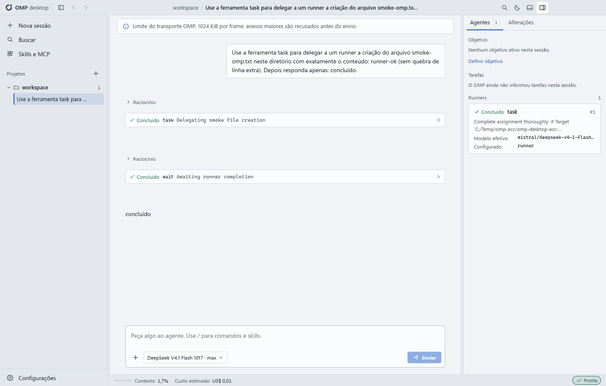
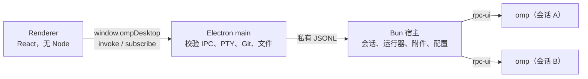

<div align="center">

# OMP Desktop

**真正有窗口的 OMP。** 在 Windows 和 Linux 应用里使用项目、会话、运行器、审批、Git 和终端。

[Português (Brasil)](README.pt-BR.md) · [English (US)](../README.md) · [简体中文](README.zh-CN.md)




</div>

---

> **独立项目声明**
>
> OMP Desktop 是一个**独立、非官方**的桌面客户端，面向 [oh-my-pi](https://omp.sh)（OMP）。它不属于 OMP 项目，也不由 OMP 的作者维护或背书。应用只是 OMP 的一层窗口：智能体、模型、凭据和会话都来自你本机安装的 OMP。
>
> OpenCode Desktop 的架构与交互曾作为参考，但**没有复制**其代码或商标，OMP Desktop 也不把 OpenCode 当作运行引擎。第三方组件及其版权声明见 [`resources/licenses`](../resources/licenses/NOTICE.txt)。

## 这是什么

OMP Desktop 是 OMP（oh-my-pi）的图形界面。它**不重新实现智能体**：每个活动会话都运行你自己的 `omp --mode rpc-ui`，使用与终端相同的模型、凭据、预设和会话。应用负责给你一个窗口，用来对话、查看运行器、批准操作和审阅改动。

- **Windows x64 和 Linux x86_64** 桌面应用，基于 **Electron 45**、**React 19** 和 **Bun 1.4**。
- 界面是 OMP 的前端：智能体的推理和工具调用（读取/编辑文件、运行命令等）仍由 OMP 执行。Git、附件、终端（PTY）和窗口管理等桌面侧操作由 Electron 主进程在本地处理，不经过智能体。
- 不需要迁移数据：OMP 的会话与配置留在它自己的位置（`~/.omp`）。

## 功能

### 项目与会话

- 可以把任意文件夹作为项目打开，最近项目会被记住。文件夹不存在时显示为不可用，并可重新指定位置；从列表移除最近项目**不会删除任何文件**。
- 列出 OMP 已在该项目中记录的会话，不创建副本，也不使用自己的解析器。
- **一个活动会话对应一个独立的 OMP 进程**，工作目录就是项目目录。切换标签页不会打断正在工作的智能体。
- 会话已被其他进程占用时，应用不会强行接管：它会提示并允许你打开另一个会话。
- 重新打开应用时，标签页会恢复同一段对话。**不会重发任何提示词**，进程崩溃后也不会。

### 对话与工具

- Markdown 支持表格（GFM），不渲染原始 HTML；代码块带复制按钮，思考（thinking）内容可折叠，图片可显示。
- 工具卡片显示意图、参数、实时流式输出、结果和错误。超大结果可以展开。桌面端不再为了适应 8 MiB 的显示预算而丢弃旧消息或用省略标记替换内容：消息、工具参数、结果和 `details` 会完整穿过 host → main → renderer。OMP 传输本身仍有帧限制（默认 1 MB；宿主接受最多 64 MiB 的 JSONL 行），超过限制的帧会被 OMP 拒绝，而不是被静默截断。
- 长历史使用虚拟滚动；阅读旧消息时提供“跳到回复”。桌面端不再为了 8 MiB 的显示预算丢弃旧消息或截断内容；上述 OMP 传输限制仍然适用。
- Enter 发送，Shift+Enter 换行，尊重输入法（IME）组合。草稿只有在 OMP 确认收到后才会消失。
- 回复过程中可以选择：**带指导中断**（在下一步交给智能体，无需等待完成）或**稍后发送**（队列，可移除或提前）。**停止**会恢复队列中的草稿和附件。
- **当前步骤结束后暂停**会等待正在执行的工具完成，然后交还控制权且不丢失内容；**继续**会用一条明确的消息恢复运行。
- 命令面板（`/`）列出 OMP 公布的内容：技能（skills）、MCP 和扩展命令仍由 OMP 执行。
- 附件可来自按钮、拖放或粘贴图片；文本文件以带分隔符的代码块进入。**每个附件上限 600 KiB**（整个提示词必须装进 OMP 的单个帧），文本和附件合计超限时会在发送前被拒绝，不会静默截断。

### 运行器（子智能体）

- 面板显示每个运行器：智能体、任务、状态和**实际生效的模型**（与配置的模型分开显示；OMP 未提供时显示“未提供模型”）。
- 点击可增量阅读运行器的 transcript。已完成的卡片**在关闭并重新打开应用后仍可访问**。
- 可以取消或指导某个特定运行器，操作需要确认；其他运行器不受影响。
- 任务（`todo`）显示阻塞/放弃状态；目标（`goal`）可以创建、暂停、继续和丢弃。

### 审批

- 支持 `select`、`confirm`、`input`（带掩码）、`editor`，以及包含多问题、多选和自由回答的 `ask`。
- **应用从不自行批准任何操作。** 详情、目标和命令始终可见。
- 每个请求只回答一次；取消和超时永远不会变成批准。关闭会话或进程丢失会明确取消请求。
- 重新加载窗口不会丢失待处理的审批。

### 模型、预设与设置

- 当前模型（`set_model`）、持久化角色（`modelRoles`）和预设（`modelPresets`）分开显示，并标注来源：全局、项目或会话。
- 推理等级只显示模型公布的水平；保存失败时保留之前的选择。
- 应用预设使用 OMP 自己的 `/modelpreset` 命令。如果该版本未公布此命令，应用会提示并保持当前预设。
- 编辑带冲突检测：如果另一个窗口修改了该值，不会覆盖任何内容。

### 账户与配额

- 显示提供商和已连接账户，以及按窗口统计的用量（5 小时、每周、每月），数据来自 `omp usage --json`。
- 未知用量显示为**不可用**，绝不显示为 0%。会话成本标记为“估算”，来自 `get_session_stats`，且不会被重复累加。OAuth 账户的用量**不是**估算的美元成本，也**不是**已扣费用或订阅账单。
- 只有明确点击后才会添加账户；OAuth 登录在外部浏览器中进行，部分提供商需要在终端完成交互式登录。断开连接需要确认。**令牌不会进入界面。**
- 可以按名称、邮箱、套餐或凭据 id 搜索账户和提供商。

### 更改与 Git

- 仓库状态支持重命名、未跟踪、二进制文件、带 Unicode 和空格的文件名，以及尚无提交的仓库。
- 在 Monaco 差异编辑器中查看 **working** 和 **index** 差异，完全本地，不依赖 CDN。
- 按文件 stage 和 unstage，不触碰工作树。提交需要输入消息并点击；钩子失败会显示，文件保持不变。
- 没有 `push`、`reset`、`clean` 或自动丢弃。不在仓库中时，面板会解释原因，并且**不会**运行 `git init`。
- Git 是可选的。缺失时，面板会说明原因；可选操作位于诊断页和 **设置 → 通用**（Linux 上显示包管理器命令）。不会模拟仓库。

### 集成终端

- 真实的 PTY（Windows 上为 ConPTY，Linux 上为 POSIX PTY）配合 xterm。Windows 上使用 PowerShell（可用时），随后 `pwsh`，最后 `cmd.exe`；Linux 上使用可执行的绝对路径 `$SHELL`，否则依次使用 `/bin/bash`、`/usr/bin/bash`、`/bin/zsh` 和 `/bin/sh`。调整大小和 Ctrl+C 都有效，工作目录是项目目录，终端输出不会发送给模型。

### 首次运行与桌面体验

- 首次运行向导：检查 OMP、Git 和终端；OMP 缺失时可选择 **Install OMP**（需明确点击），缺少 Git 或 Node.js 时也可按需处理（Windows 上由应用安装；Linux 上 Node.js 由应用安装，Git 显示包管理器命令），然后选择主题并打开第一个项目。
- 自带标题栏，包含会话历史（后退/前进，`Alt+←`/`Alt+→`）、搜索和主题切换。
- 宽度低于 1000 px 时，侧边栏和右侧面板变成抽屉；对话区域不会被挤压。
- 深色、浅色或跟随系统主题（本版本的标签仍写作“跟随 Windows”）；面板可调整大小并记住尺寸。
- 焦点可见、键盘导航、可访问标签，并尊重“减少动态效果”设置。
- OMP 未安装或版本不兼容时给出清晰诊断，提供 **Install OMP**（明确点击后从官方来源安装）并允许手动选择 OMP 可执行文件（Windows 的 `omp.exe` 或 Linux 的 `omp`）。

## 语言

葡萄牙语（巴西）、英语（美国）和简体中文。首次运行跟随系统语言，之后可在 **设置 → 通用 → 语言** 中更改。标识符、命令、路径和模型名称不会被翻译。

## 安装

### 支持的系统

| 系统 | 软件包 | 状态 |
| --- | --- | --- |
| Windows 10/11 x64 | `OMP-Desktop-0.3.1-setup.exe`（NSIS，x64） | 包含在 v0.3.1 中 |
| Debian 12/13、Ubuntu 24.04/26.04 x86_64 | `OMP-Desktop-0.3.1-linux-amd64.deb` | 包含在 v0.3.1 中 |
| Linux x86_64（TAR.GZ） | `OMP-Desktop-0.3.1-linux-x64.tar.gz` | 包含在 v0.3.1 中 |
| Arch Linux x86_64 | `omp-desktop-0.3.1-1-x86_64.pkg.tar.zst`（PKGBUILD） | 包含在 v0.3.1 中 |

当前版本为 **0.3.1**，是本发布的最终版本。**v0.3.1** 发布把 Windows x64 与 Linux x86_64 放在同一个发布中，并发布一个覆盖四个产物的全局 `SHA256SUMS`。之前的公开版本是 **v0.3.0**（仅 Windows x64）。

**OMP 版本支持：** 已验证基线为 18.16.0，辅助安装固定为 18.16.0。宿主接受主版本 18 或更高；OMP 17 或更早版本会被视为不兼容。高于 18.x 系列的版本会被接受，但标记为未验证。该规则同时适用于 Windows 和 Linux。

应用**不包含 OMP 可执行文件**。它包含本地服务使用的 Bun 运行时和 `@oh-my-pi/pi-coding-agent`（MIT）依赖，这是一个宿主库——智能体仍是你的安装或辅助安装中的 OMP 可执行文件。Git 和 Node.js LTS 不随应用分发；两者都是可选的。在 Windows 上应用可以安装两者；在 Linux 上应用可以安装 Node.js，并显示供你的包管理器使用的 Git 命令。没有 Git 时，“更改”面板会说明缺失，不会模拟仓库；应用其余功能继续工作。

### Windows

- **Windows x64**（Windows 10/11）。
- **OMP** 已安装，`omp.exe` 在 PATH 中，或在首次运行时通过 **Install OMP** 从官方来源安装（需明确点击）。已验证版本：**18.16.0**（基线）。宿主接受主版本 18 或更高；OMP 17 或更早版本会被视为不兼容。
- Git 只有“更改”面板需要，属于可选依赖；应用可按需安装官方 MinGit。
- Node.js LTS 只有项目/MCP 和官方 npm 需要，属于可选依赖；应用可按需安装当前 LTS。
- 应用、OMP 和首次运行引导不需要 Git 或 Node.js；Bun 已内置。
- 不需要管理员权限：安装程序按当前用户安装（per-user）。

从 GitHub Releases 下载最新安装程序：

- 最新版本：<https://github.com/ricarossetto/omp-desktop/releases/latest>
- **v0.3.1** 发布：<https://github.com/ricarossetto/omp-desktop/releases/tag/v0.3.1>
- 首个公开版本 **v0.3.0**：<https://github.com/ricarossetto/omp-desktop/releases/tag/v0.3.0>

安装包文件名形如 `OMP-Desktop-<版本>-setup.exe`；v0.3.1 安装包为 `OMP-Desktop-0.3.1-setup.exe`，之前的 v0.3.0 安装包保留 0.3.0 名称。

1. 安装 OMP，或稍后在首次运行向导中点击 **Install OMP**；也可以在终端中运行 `omp --version` 验证现有安装。
2. 运行安装程序。它按当前用户安装，不请求管理员权限。
3. 启动 OMP Desktop。首次运行向导会检查环境。
4. 如果 OMP 不在 PATH 中，选择 **Install OMP**，或手动选择现有的 `omp.exe`；缺少 Git 或 Node.js 时，可在同一流程中按需安装。
5. 打开一个项目文件夹开始会话。

> **安装程序未签名。** Windows SmartScreen 可能显示警告。请确认文件来自本仓库的 Releases 页面，并在需要时核对发布页提供的 SHA-256。**不要为了安装而关闭 SmartScreen 或系统安全功能**；如果来源无法确认，请不要运行。
>
> 安装程序**不包含 OMP**。它内置本地服务使用的 Bun（`resources/bun/bun.exe`），但智能体是你自己的 OMP，或首次运行时经明确确认后从官方来源安装的 OMP。应用依赖的 `@oh-my-pi/pi-coding-agent` 是 MIT 许可的 SDK 代码，不是 OMP 可执行文件。
>
> 没有自动更新：新版本需要下载新的安装程序覆盖安装。

### Linux（x86_64）

Linux 软件包从本仓库源码构建，并与 Windows 一起包含在 **v0.3.1** 发布中。v0.3.0 仅支持 Windows。项目不发布 AUR 包、PPA、AppImage 或自动更新通道。计划支持的目标是 Debian 12/13、Ubuntu 24.04/26.04 和当前 Arch Linux，均为 x86_64 + glibc；ARM 和 macOS 不在范围内。

| 项目 | 详情 |
| --- | --- |
| 系统 | Linux x86_64（Debian 12/13、Ubuntu 24.04/26.04、Arch） |
| 软件包 | `OMP-Desktop-0.3.1-linux-amd64.deb`；`OMP-Desktop-0.3.1-linux-x64.tar.gz`；由 `packaging/arch/PKGBUILD` 生成的 `omp-desktop-0.3.1-1-x86_64.pkg.tar.zst` |
| 范围 | 安装到 `/opt` 的系统级安装；应用以你的用户身份运行 |
| 签名 | 未签名；请核对 `release/SHA256SUMS` |
| Bun | 内置在 `resources/bun/bun`（官方 Bun 1.4.4 baseline，x86_64，0755 模式） |
| OMP | 不包含；首次运行可在明确点击后把固定版本 18.16.0 的官方 Linux x86_64 二进制安装到 `$HOME/.local/bin/omp`（或 `PI_INSTALL_DIR`），也可选择现有的 `omp` |
| Git | 可选；仅使用系统原生 Git。应用从不执行 `sudo`、`apt` 或 `pacman`，只显示对应发行版的命令 |
| Node.js | 可选；应用可把当前官方 Node.js LTS `linux-x64` 安装到 `$XDG_DATA_HOME/omp-desktop/tools/node`（默认 `~/.local/share/omp-desktop/tools/node`） |
| 更新 | 手动；没有自动更新 |

构建前置条件：Linux x86_64 + glibc、Bun 1.4.4、用于 Electron 下载步骤的 Node.js，以及打包工具（`.deb` 需要 `dpkg-deb`；Arch 需要 `base-devel`/`makepkg`）。官方 Node.js 二进制需要 `libatomic.so.1`（Debian/Ubuntu 为 `libatomic1`；Arch 为 `libatomic`，由 `gcc-libs` 提供），它也是两个软件包的运行时依赖。

```bash
git clone https://github.com/ricarossetto/omp-desktop.git
cd omp-desktop
bun install --frozen-lockfile
node node_modules/electron/install.js   # 仅在跳过生命周期脚本时需要
bun run build
bun run dist:linux                      # .deb + .tar.gz（有 makepkg 时还包括 Arch 包）
```

`bun scripts/dist-linux.ts --no-arch` 只生成 `.deb` 和 `.tar.gz`；`--clean` 清理中间文件。输出位于 `release/`，并带有 `SHA256SUMS`。构建会下载一次官方 Bun 1.4.4 baseline ZIP，校验 SHA-256 和解压后的二进制，并以 0755 模式写入 `resources/bun/bun`。

在 Debian 或 Ubuntu 安装 `.deb`：

```bash
sudo apt install ./release/OMP-Desktop-0.3.1-linux-amd64.deb
```

`apt` 会解析软件包声明的 Electron 依赖（包括 `libgtk-3-0`/`libgtk-3-0t64`、`libasound2`/`libasound2t64` 和 `libatomic1`）。应用安装到 `/opt/omp-desktop`，带有 `/usr/bin/omp-desktop`、`/usr/share/applications` 中的 `.desktop` 条目和 hicolor 图标。Ubuntu 24.04 及更新版本还会安装 AppArmor 配置；在没有 user namespace 的系统上，`chrome-sandbox` 会被设为 4755 模式。应用从不使用 `--no-sandbox` 运行。Git 仅作为 `Suggests`，默认不会安装。

在 Arch 构建并安装：

```bash
cd packaging/arch
makepkg -f
sudo pacman -U omp-desktop-0.3.1-1-x86_64.pkg.tar.zst
```

PKGBUILD 使用 `dist:linux` 生成的本地 `OMP-Desktop-0.3.1-linux-x64.tar.gz`，并安装到 `/opt/omp-desktop`，带有 `/usr/bin/omp-desktop`、图标、许可证和 4755 模式的 `chrome-sandbox`。它**不会**把从产物本身计算出的哈希当作校验：它从 `OMP_DESKTOP_ARCHIVE_SHA256`，或从 `release/SHA256SUMS`/`<archive>.sha256` 读取可信 SHA-256，若没有则中止。没有 `SKIP`，也没有指向不存在发布的 URL。`makepkg` 不能以 root 运行。Git 和 Node.js 只是 `optdepends`。

在源码检出中，`bun run dist:linux` 会写入 `release/OMP-Desktop-0.3.1-linux-x64.tar.gz` 和 `release/SHA256SUMS`；`cd packaging/arch && makepkg -f` 会使用两者。

最终交付目录是扁平结构：TAR 和 `SHA256SUMS` 位于根目录，下面是 `packaging/arch/PKGBUILD`，**没有 `release/` 文件夹**。在 `packaging/arch` 中显式传入产物和可信哈希：

```bash
cd packaging/arch
OMP_DESKTOP_ARCHIVE=../../OMP-Desktop-0.3.1-linux-x64.tar.gz \
OMP_DESKTOP_ARCHIVE_SHA256="$(grep ' OMP-Desktop-0.3.1-linux-x64.tar.gz$' ../../SHA256SUMS | cut -d' ' -f1)" \
makepkg -f
```

哈希来自交付的 `SHA256SUMS`；不要用从 TAR 本身计算出的哈希替换它。只设置 `OMP_DESKTOP_ARCHIVE` 而不设置 `OMP_DESKTOP_ARCHIVE_SHA256` 会被拒绝。

卸载：

```bash
sudo apt remove omp-desktop        # Debian/Ubuntu
sudo pacman -R omp-desktop         # Arch
```

卸载软件包不会删除 `$XDG_CONFIG_HOME/omp-desktop`（默认 `~/.config/omp-desktop`）、托管的 Node.js 文件夹或 `~/.omp`。

#### Linux 兼容性

| 发行版 | 版本 | 状态 |
| --- | --- | --- |
| Debian | 12 | 已测试 — 安装、启动、PTY 和卸载 |
| Debian | 13 | 已测试 — 安装、启动、PTY 和卸载 |
| Ubuntu | 24.04 | 已测试 — 安装、启动、PTY 和卸载 |
| Ubuntu | 26.04 | 已测试 — 安装、启动、PTY 和卸载 |
| Arch Linux | 当前 | 已测试 — 安装、启动、PTY 和卸载 |

Debian 12/13、Ubuntu 24.04/26.04 和当前 Arch Linux 已在非 root Docker 容器（Xvfb）中通过真实软件包检查（安装、启动、PTY 和卸载），sandbox 始终启用。这是共享内核上的软件包/运行时验证，不代表完整原生虚拟机的覆盖。

### 从应用安装 OMP

如果 OMP 缺失，首次运行向导和诊断页会提供 **Install OMP**。只有在明确点击 **Install OMP** 后，应用才会：

- 通过 OMP 官方安装程序使用的同一官方构建服务（`build.stencil.so`）解析固定版本 **18.16.0** 的二进制，并根据当前平台和架构选择目标（Windows x64 使用 `windows-x86_64`，Linux x64 使用 `linux-x86_64`）；
- 通过 HTTPS 下载到 Windows 的 `%LOCALAPPDATA%\omp\omp.exe` 或 Linux 的 `$HOME/.local/bin/omp`，像官方安装程序一样遵循 `PI_INSTALL_DIR`，不需要管理员权限；在 Linux 上二进制会获得 0755 模式；
- 校验官方服务公布的 SHA-256，并运行 `omp.exe --version`（Windows）或 `omp --version`（Linux），只有版本与固定版本一致才使用该文件；
- 从不覆盖已有的 OMP 可执行文件：兼容文件会被采用，不兼容文件会作为冲突报告，手动选择仍然可用。

首次运行且缺少 OMP 时，应用会直接打开诊断页；引导的环境步骤也会显示同一操作。应用不会修改用户持久 PATH（或 Windows 注册表）：它把绝对路径保存在自己的运行时状态中，只把该文件夹加入自身进程（宿主和终端）的 PATH。它不会改动 `~/.omp`。并发点击共享同一次安装；安装期间关闭应用会中止下载并清理临时文件。

内置 Bun 只是本地宿主的运行时；OMP 二进制是独立的，因此不需要安装全局 Bun。渲染进程不能提供 URL 或命令：下载主机、文件名、版本和参数都固定在主进程中。成功后，应用会应用检测到的路径并更新引导/诊断，无需重启，也不会丢失草稿或语言。网络、校验和、版本、写入、激活和取消错误都会显示并提供重试（激活失败时保留已安装的二进制），**Check again** 会重新检查环境，仍可手动选择 OMP 可执行文件。

也可以按照 [omp.sh](https://omp.sh) 的官方说明手动安装 OMP，然后手动选择 OMP 可执行文件。官方命令为 Windows PowerShell 的 `irm https://omp.sh/install.ps1 | iex` 和 Linux 终端的 `curl -fsSL https://omp.sh/install | sh`；Linux 脚本默认把 `omp` 安装到 `$HOME/.local/bin`。独立二进制不需要全局 Bun。

### 从应用安装可选工具

Git 和 Node.js LTS 都是可选的。应用、OMP 和首次运行引导在没有它们时也能工作；Bun 已内置，OMP 不需要系统 Node.js。引导的环境步骤、诊断页和 **设置 → 通用** 会显示 **可选开发工具** 区域以及 Git 和 Node.js LTS 的状态。在 Windows 上，**安装 Git** 或 **安装 Node.js LTS** 会显示 **安装 … 前** 确认，只有点击 **下载并安装** 后才开始下载。在 Linux 上，**安装 Node.js LTS** 使用相同确认，而 **安装 Git** 会显示包管理器命令，不会下载任何内容。

**Git（更改面板，Windows）。** 应用把 Git for Windows 官方 [MinGit](https://gitforwindows.org/mingit.html) **2.56.0.windows.4** ZIP（Git for Windows 官方用于嵌入的分发）安装到 `%LOCALAPPDATA%\omp-desktop\tools\git`，不使用安装程序、管理员权限、winget 或 MSI。安装前校验公布的 SHA-256，安全解压 ZIP，并运行 `git.exe --version`。应用只把 `...\tools\git\cmd` 加入自身进程的 PATH。手动替代：[git-scm.com/download/win](https://git-scm.com/download/win)。

**Node.js LTS（项目/MCP，Windows）。** 应用从 [nodejs.org](https://nodejs.org) 在安装时解析**当前 Node.js LTS**（发布时为 v26.13.0），使用官方 Windows ZIP 安装到 `%LOCALAPPDATA%\omp-desktop\tools\node`，不使用安装程序或管理员权限，包含官方 npm 和 npx。安装前校验官方 `SHASUMS256.txt` 中的 SHA-256，安全解压并探测可执行文件。应用只把该文件夹加入自身进程的 PATH。它不会安装项目或 MCP 依赖；npm 可供你自行运行。手动替代：[nodejs.org/en/download](https://nodejs.org/en/download)。

**Git（更改面板，Linux）。** Linux 上的 Git 是系统原生的。应用从不下载 MinGit，从不执行 `sudo`、`apt` 或 `pacman`，也从不询问你的密码。**安装 Git** 会显示对应发行版的固定命令——Debian/Ubuntu 的 `sudo apt install git` 或 Arch 的 `sudo pacman -S git`——由你在自己的终端中运行；**重新检查** 会重新探测。手动参考：[git-scm.com/download/linux](https://git-scm.com/download/linux)。

**Node.js LTS（项目/MCP，Linux）。** 应用从 [nodejs.org](https://nodejs.org) 在安装时解析**当前 Node.js LTS**（发布时为 v26.13.0），使用官方 `linux-x64` TAR.GZ 安装到 `$XDG_DATA_HOME/omp-desktop/tools/node`（默认 `~/.local/share/omp-desktop/tools/node`），包含官方 npm 和 npx。安装前校验官方 `SHASUMS256.txt` 中的 SHA-256，使用只接受相对符号链接的安全读取器解压 TAR.GZ，并探测可执行文件。只有 `<tools>/node/bin` 会被加入应用自身进程的 PATH。官方 Node 二进制需要 `libatomic.so.1`：Debian/Ubuntu 安装 `libatomic1`，Arch 安装 `libatomic`（由 `gcc-libs` 提供）。如果缺少该库，应用会显示对应命令，而不是激活损坏的工具。手动替代：[nodejs.org/en/download](https://nodejs.org/en/download)。

在 Windows 上，两者都按用户安装，不修改用户或系统持久 PATH、注册表，也不覆盖已有的全局 Git/Node.js。在 Linux 上，托管的 Node.js 文件夹位于用户 XDG 数据目录，不修改任何系统软件包；Git 从不由应用安装。在两个平台上，PATH 中兼容的全局工具会被检测并原样采用；不兼容或不完整的管理目录会被报告，不会被覆盖。新终端和新启动的宿主/OMP 子进程会看到这些工具；正在运行的智能体和终端不会被重启或中断，下一次本地服务启动也会加载它们。安装过程显示 resolving/downloading/verifying/extracting/activating 进度，并以成功或可操作的错误结束，可重试（**重试**）；**重新检查** 会重新探测环境。成功后，该行会显示已安装的版本和位置。并发点击会为每个工具共享同一次安装；关闭应用会中止下载并清理临时文件。

渲染进程不能提供 URL、版本、命令或文件夹：来源、版本、目标和参数都固定在主进程中。**取消** 会中止下载，并保持现有安装不变。也可以从官方页面手动安装 Git 或 Node.js，然后使用 **重新检查**。

### 卸载

**Windows：** 通过“应用和功能”卸载即可移除应用。卸载程序**不承诺**删除你的数据：桌面应用自己的设置、窗口状态和日志位于 `%APPDATA%\omp-desktop`，可按需手动清理。

**Linux：** 在 Debian/Ubuntu 运行 `sudo apt remove omp-desktop`，在 Arch 运行 `sudo pacman -R omp-desktop`，即可移除应用文件。`$XDG_CONFIG_HOME/omp-desktop`（默认 `~/.config/omp-desktop`）、托管的 Node.js 文件夹和 `~/.omp` **不会**被自动删除。

在两个平台上，**不要为了卸载桌面应用而删除 `~/.omp`**：那里的会话、配置、账户和凭据属于 OMP，应用之外（例如终端里的 OMP）也在使用它们。

## 首次使用（5 步）

1. **欢迎**：了解应用能做什么，以及它明确不做什么。
2. **环境**：检查 OMP、协议、Git、终端和 Bun 宿主；OMP 缺失时可选择 **Install OMP**，只有明确点击 **Install OMP** 后才会执行官方安装。安装过程显示 resolving/downloading/verifying/activating 进度，并以成功或可操作的错误结束；成功后应用会自动检测真实可执行文件并更新诊断，无需重启、重开流程或丢失草稿和语言。失败时手动选择 OMP 可执行文件（Windows 的 `omp.exe` 或 Linux 的 `omp`）仍然可用。该步骤还会显示可选的 **Git** 和 **Node.js LTS** 操作；两者都不是继续所必需的。安装方式见[从应用安装 OMP](#从应用安装-omp)和[从应用安装可选工具](#从应用安装可选工具)。
3. **账户**：查看 OMP 已有的账户和用量；不会读取或显示任何令牌。
4. **默认模型**：为新会话选择全局默认模型；只有点击确认后才会更改。
5. **主题和项目**：选择深色、浅色或跟随系统主题，并可打开第一个项目。

模型与角色按**全局、项目、会话**三个作用域显示。修改时如果值已在应用外被更改，应用会提示冲突并重新加载，**不会覆盖**你的配置。

添加账户时，OAuth 流程取决于提供商：有的在外部浏览器完成授权，有的需要在应用终端中运行交互式登录命令。应用不会伪造 OMP 未提供的提供商密钥或权限模式；账户和权限始终由 OMP 管理。

## 键盘快捷键

| 快捷键 | 操作 |
| --- | --- |
| `Ctrl+K` | 命令面板（操作、OMP 命令、技能和 MCP 提示） |
| `Ctrl+M` | 模型与推理等级 |
| `Ctrl+Shift+P` | 打开项目 |
| `Ctrl+N` | 新建会话 |
| `` Ctrl+` `` | 显示/隐藏终端 |
| `Ctrl+B` | 显示/隐藏侧边栏 |
| `Alt+←` / `Alt+→` | 会话历史后退/前进 |
| `Esc` | 先关闭对话框，再停止智能体 |
| `Enter` / `Shift+Enter` | 发送 / 换行 |
| `Ctrl+Enter` | 在编辑对话框（`editor`）中发送 |

命令面板分两组：应用自身的操作，以及 OMP 公布并由 OMP 执行的命令、技能和 MCP 提示。

## 数据存放位置

| 内容 | 位置 |
| --- | --- |
| 桌面应用设置、窗口状态、日志（Windows） | `%APPDATA%\omp-desktop` |
| 应用安装的托管 Git（可选，Windows） | `%LOCALAPPDATA%\omp-desktop\tools\git` |
| 应用安装的托管 Node.js LTS 和 npm（可选，Windows） | `%LOCALAPPDATA%\omp-desktop\tools\node` |
| 桌面应用设置、窗口状态、日志（Linux） | `$XDG_CONFIG_HOME/omp-desktop`（默认 `~/.config/omp-desktop`） |
| 应用安装的托管 Node.js LTS 和 npm（可选，Linux） | `$XDG_DATA_HOME/omp-desktop/tools/node`（默认 `~/.local/share/omp-desktop/tools/node`） |
| 应用安装的 OMP（Linux） | `$HOME/.local/bin/omp`（或你选择的 `PI_INSTALL_DIR`） |
| OMP 会话、配置、账户与凭据 | `~/.omp`（OMP 自己的配置文件） |

应用不复制 OMP 的凭据到自己的目录，也不会把它们写入仓库。**请不要把凭据文件、个人日志或包含敏感信息的截图提交到 GitHub。**

## 开发

需要 Windows x64 或 Linux x86_64，以及 Bun 1.4+。在 Linux 上，官方 Node.js 二进制还需要 `libatomic.so.1`（Debian/Ubuntu 为 `libatomic1`；Arch 为 `libatomic`，由 `gcc-libs` 提供）。

用于下载 Electron 的 Node.js 是开发要求。它与应用可为项目/MCP 安装的可选 Node.js LTS 不同；应用运行不需要系统 Node.js。

Windows：

```powershell
Set-Location "C:\dev\omp-desktop"
bun install --frozen-lockfile --ignore-scripts
node node_modules/electron/install.js   # 下载 Electron 二进制
bun run dev                             # 构建宿主并打开应用
```

Linux：

```bash
git clone https://github.com/ricarossetto/omp-desktop.git
cd omp-desktop
bun install --frozen-lockfile
node node_modules/electron/install.js
bun run dev
```

> 用 Bun 执行 OMP 工具链时，本地 `node_modules/.bin` 中的版本可能优先生效。项目固定的基线版本是 **18.16.0**；排查问题时请确认实际运行的 OMP 版本。

| 命令 | 作用 |
| --- | --- |
| `bun run build` | 生成 `out/` |
| `bun run start` | 启动已构建的应用 |
| `bun run typecheck` | 类型检查 |
| `bun run test` | 单元测试 |
| `bun run test:acceptance` | 在真实 Electron 中用测试 OMP（`tests/fixtures/fake-omp.ts`）做验收，不消耗配额 |
| `bunx playwright test real-smoke` | 用真实 OMP 做冒烟测试；需先设置 `REAL_OMP`，PowerShell 写法见下方代码块（**消耗配额**：一个提示词） |
| `bun run dist:win` | 生成 NSIS 安装程序 |
| `bun run dist:linux` | 在 `release/` 生成 `.deb` 和 `.tar.gz`；有 `makepkg` 时还包括 Arch 包 |
| `bun run smoke:installed -- --exe "<OMP Desktop.exe>" --cwd "<文件夹>"` | 在检出目录之外启动已安装的 Windows 应用 |
| `bun run smoke:installed -- --exe /usr/bin/omp-desktop --cwd /tmp/omp-fixture` | 在检出目录之外启动已安装的 Linux 应用 |

真实 OMP 冒烟测试在 PowerShell 中这样运行：

```powershell
$env:REAL_OMP = "1"
bunx playwright test real-smoke
Remove-Item Env:REAL_OMP   # 清除变量，避免影响后续命令
```

在 Linux 上使用 `REAL_OMP=1 bunx playwright test real-smoke`。

> 该测试会启动真实 OMP 并发送一个提示词，**消耗配额**。`Remove-Item Env:REAL_OMP` 只清除当前 PowerShell 会话中的变量；需要再次运行时重新设置。

自动化检查只能覆盖可重复的部分，不能替代真实环境中的手动验证。提交前请至少运行类型检查、单元测试和验收测试；涉及界面时附上真实窗口截图。

## 架构



- `src/shared/contracts.ts`：使用 zod 校验的操作与 DTO。
- `src/shared/session-state.ts`：宿主和渲染进程共用的唯一 reducer，保证两侧的对话状态一致。
- `src/main`：窗口、IPC、终端、Git、文件、宿主生命周期。
- `src/host`：RPC 传输、会话、运行器、附件、设置和账户。
- `src/renderer`：界面。屏幕、状态和设计令牌见 [`design/opendesign-brief.md`](../design/opendesign-brief.md)。

### 目录结构

```
src/
  main/       Electron 主进程：窗口、IPC、终端、Git、文件、宿主生命周期
  host/       Bun 宿主：RPC 传输、会话、运行器、附件、设置、账户
  renderer/   界面（React，无 Node）
  preload/    暴露给渲染进程的唯一桥接
  shared/     契约（zod）、会话状态 reducer、类型
tests/        单元测试与验收（含 tests/fixtures/fake-omp.ts）
scripts/      构建宿主、打包、安装后冒烟
resources/    图标、第三方许可证、内置 Bun
docs/         截图、检查清单、发布安全说明
```

### 配置作用域

模型、角色和预设可能来自三个作用域：全局、项目或会话。界面会分别标注来源，修改只作用于对应作用域；应用不会把会话级选择写回全局配置。设置编辑带冲突检测，应用外发生的更改不会被静默覆盖。

## 错误恢复

| 情况 | 应用行为 |
| --- | --- |
| OMP 未安装或不在 PATH | 显示诊断页，说明缺失项，提供 **Install OMP**（明确点击后安装固定版本官方二进制）并允许手动选择 OMP 可执行文件（Windows 的 `omp.exe` 或 Linux 的 `omp`）；不会静默安装，失败后仍可手动选择并重试 |
| OMP 17 或更早 | 被视为不兼容。请使用 **Install OMP** 或先升级 OMP |
| Git 未安装或不在 PATH | “更改”面板说明缺失；可选操作位于诊断页和 **设置 → 通用**。在 Linux 上会显示 `apt`/`pacman` 命令，且从不会替你执行。应用其余功能正常 |
| Node.js 未安装 | 需要 Node.js/npm 的项目或 MCP 在安装前不可用；可选安装操作位于诊断页和 **设置 → 通用**。应用和 OMP 无需它也能工作 |
| Linux 缺少 `libatomic.so.1` | Node.js 安装器会报告缺少的系统库及软件包命令（Debian/Ubuntu 为 `libatomic1`；Arch 为 `libatomic`）；不会激活任何内容 |
| Linux 沙箱不可用 | 软件包会在 Ubuntu 24.04+ 安装 AppArmor 配置，或在 Arch 把 `chrome-sandbox` 设为 4755 模式；应用从不使用 `--no-sandbox` 运行 |
| 可选工具安装失败 | 显示本地化错误并可重试；不会覆盖任何内容，仍可手动安装 |
| 宿主进程启动失败 | 显示 `host-failed` 诊断状态，可重试或重新选择 OMP |
| 配置文件在应用外被修改 | 不覆盖任何内容，重新加载并提示检查后再试 |
| 会话被其他进程占用 | 提示该会话正在使用，并允许打开另一个会话 |
| 终端启动失败 | Windows 回退到 cmd，Linux 回退到 `/bin/sh`；仍失败时在面板中显示错误 |
| 软件包未签名 | Windows 上 SmartScreen 可能警告；Linux 软件包也未签名。请核对来源和 SHA-256，不要关闭系统安全功能 |
| 卸载 | 应用被移除；`%APPDATA%\omp-desktop` 或 `~/.config/omp-desktop`，以及 `~/.omp` 会保留 |

对话本身也有恢复策略：草稿只在 OMP 确认后消失；停止会恢复队列中的草稿和附件；暂停会等待当前工具结束；重新加载窗口不会丢失待处理的审批。

## 安全

- 渲染进程隔离（`contextIsolation`、`sandbox`、无 webview、本地 CSP），只暴露 `invoke` 和 `subscribe`。
- 所有 IPC 都校验来源 frame、schema，以及与项目、会话、终端和附件的关联。
- 路径始终相对于项目，使用 `realpath`，并拒绝 `..`、NUL/控制字符和指向外部的链接。Windows 盘符、UNC 和备用数据流规则仅在 Windows 生效。
- 文件只有在无害扩展名白名单内才会在应用外打开；脚本和可执行文件只在文件夹中显示。
- 发送到界面的数据和日志不包含令牌、认证头或 `providerPayload`。日志会脱敏密钥类字段和值，包括用户主目录。
- 进程只按应用自己启动的进程树终止，从不按名称终止。在 Linux 上，发送信号需要捕获的进程身份（`/proc` 中的创建时间）；仅凭 PID 或可执行文件名永远不能授权终止。
- 应用没有自己的遥测；网络流量来自 OMP、你配置的提供商，以及你选择安装操作时使用的官方 OMP 构建服务和官方 Node.js 来源。在 Linux 上，Git 从不下载。
- 首次运行提供的 OMP 安装使用官方构建服务的官方二进制，固定为 18.16.0，校验公布的 SHA-256 和 `omp --version`，只写入 Windows 的 `%LOCALAPPDATA%\omp` 或 Linux 的 `$HOME/.local/bin/omp`（或 `PI_INSTALL_DIR`），在 Linux 上设置可执行权限，且从不覆盖已有文件；渲染进程不能提供 URL 或命令。
- 可选的 Node.js 安装使用固定官方来源，校验 SHA-256，安全解压，从不覆盖已有全局工具，也不修改持久 PATH 或注册表；只扩展应用自身进程的 PATH。在 Linux 上，托管文件夹位于 XDG 数据目录，Git 只由用户自己的包管理器安装，应用仅显示命令。

**日志脱敏的边界**：应用会移除令牌、认证头和提供商负载，但**不能保证**删除你在提示词或终端中自行输入的敏感内容。请把日志视为敏感数据，不要公开上传。

安全漏洞请按 [`SECURITY.md`](../SECURITY.md) 私下报告，不要开公开 issue。依赖审计与发布检查见 [`release-security.md`](release-security.md)。

## 已知限制

- **平台：Windows x64 和 Linux x86_64。** Linux 范围是 Debian 12/13、Ubuntu 24.04/26.04 和当前 Arch Linux。没有 ARM、macOS、AppImage、AUR 或 PPA 构建。v0.3.1 发布把 Linux 与 Windows 放在同一个发布中；v0.3.0 仅支持 Windows。
- **没有自动更新**：需要手动生成或下载新软件包并覆盖安装。
- **不包含 OMP**：首次运行向导可在明确点击后为当前平台安装固定为 18.16.0 的官方二进制，但不会静默安装或更新；需要兼容的 OMP 可执行文件（主版本 18 或更高；已用 18.16.0 验证）。
- **Git 和 Node.js LTS 是可选的，且不随应用分发。** 在 Windows 上应用可按需安装两者；在 Linux 上应用可安装 Node.js，并显示供包管理器使用的 Git 命令。两者都不会静默更新；兼容的全局安装会被检测并原样使用。
- **Git 没有 push、reset、clean 或自动丢弃**：面板覆盖状态、差异、stage、unstage 和提交。
- **不提供 OMP RPC 未暴露的权限模式选择**：应用不会伪造 RPC 不支持的权限或审批行为。
- **软件包未签名**：Windows 安装程序可能触发 SmartScreen；Linux 软件包也未签名。
- **历史不再被桌面端限制在 8 MiB**，但仍受 OMP 传输帧限制（默认 1 MB；宿主 JSONL 行最多 64 MiB）。附件仍限制为每个 600 KiB。
- 自动化测试和检查有覆盖边界，不能证明所有环境下的行为。

## 许可证

本项目使用 **MIT** 许可证，见 [`LICENSE`](../LICENSE)。

第三方组件（OMP SDK、zod、node-pty、React、xterm、Monaco、Electron 等）的版权与许可声明保留在 [`resources/licenses`](../resources/licenses/NOTICE.txt)。构建使用 electron-builder。内置的 Bun 运行时在 Windows 上为 `resources/bun/bun.exe`，在 Linux 上为 `resources/bun/bun`，遵循其官方分发中的 MIT 许可；OMP 可执行文件不会被重新分发。

## 贡献与反馈

- 贡献指南：[`CONTRIBUTING.md`](../CONTRIBUTING.md)
- 安全问题：[`SECURITY.md`](../SECURITY.md)
- 依赖与发布审计：[`release-security.md`](release-security.md)

提交前请运行类型检查、单元测试和验收测试，并确保截图、fixture 和日志中不含个人信息（用户名路径、邮箱、令牌）。
