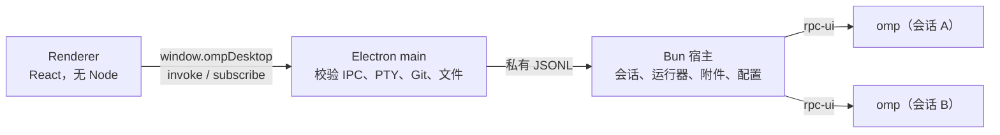

<div align="center">

# OMP Desktop

**真正有窗口的 OMP。** 在 Windows 应用里使用项目、会话、运行器、审批、Git 和终端。

[Português (Brasil)](../README.md) · [English (US)](README.en-US.md) · [简体中文](README.zh-CN.md)


</div>

---

> **独立项目声明**
>
> OMP Desktop 是一个**独立、非官方**的桌面客户端，面向 [oh-my-pi](https://omp.sh)（OMP）。它不属于 OMP 项目，也不由 OMP 的作者维护或背书。应用只是 OMP 的一层窗口：智能体、模型、凭据和会话都来自你本机安装的 OMP。
>
> OpenCode Desktop 的架构与交互曾作为参考，但**没有复制**其代码或商标，OMP Desktop 也不把 OpenCode 当作运行引擎。第三方组件及其版权声明见 [`resources/licenses`](../resources/licenses/NOTICE.txt)。

## 这是什么

OMP Desktop 是 OMP（oh-my-pi）的图形界面。它**不重新实现智能体**：每个活动会话都运行你自己的 `omp --mode rpc-ui`，使用与终端相同的模型、凭据、预设和会话。应用负责给你一个窗口，用来对话、查看运行器、批准操作和审阅改动。

- **Windows x64** 桌面应用，基于 **Electron 45**、**React 19** 和 **Bun 1.4**。
- 界面是 OMP 的前端：智能体的推理和工具调用（读取/编辑文件、运行命令等）仍由 OMP 执行。Git、附件、终端（PTY）和窗口管理等桌面侧操作由 Electron 主进程在本地处理，不经过智能体。
- 不需要迁移数据：OMP 的会话与配置留在它自己的位置（`~/.omp`）。

## 功能

### 项目与会话

- 可以把任意文件夹作为项目打开，最近项目会被记住。文件夹不存在时显示为不可用，并可重新指定位置；从列表移除最近项目**不会删除任何文件**。
- 列出 OMP 已在该项目中记录的会话，不创建副本，也不使用自己的解析器。
- **一个活动会话对应一个独立的 OMP 进程**，工作目录就是项目目录。切换标签页不会打断正在工作的智能体。
- 会话已被其他进程占用时，应用不会强行接管：它会提示并允许你打开另一个会话。
- 重新打开应用时，标签页会恢复同一段对话。**不会重发任何提示词**，进程崩溃后也不会。

### 对话与工具

- Markdown 支持表格（GFM），不渲染原始 HTML；代码块带复制按钮，思考（thinking）内容可折叠，图片可显示。
- 工具卡片显示意图、参数、实时流式输出、结果和错误。超大结果可以展开，不会截断数据。
- 长历史使用虚拟滚动；阅读旧消息时提供“跳到回复”。
- Enter 发送，Shift+Enter 换行，尊重输入法（IME）组合。草稿只有在 OMP 确认收到后才会消失。
- 回复过程中可以选择：**带指导中断**（在下一步交给智能体，无需等待完成）或**稍后发送**（队列，可移除或提前）。**停止**会恢复队列中的草稿和附件。
- **当前步骤结束后暂停**会等待正在执行的工具完成，然后交还控制权且不丢失内容；**继续**会用一条明确的消息恢复运行。
- 命令面板（`/`）列出 OMP 公布的内容：技能（skills）、MCP 和扩展命令仍由 OMP 执行。
- 附件可来自按钮、拖放或粘贴图片；文本文件以带分隔符的代码块进入。**每个附件上限 600 KiB**（整个提示词必须装进 OMP 的单个帧），文本和附件合计超限时会在发送前被拒绝，不会静默截断。

### 运行器（子智能体）

- 面板显示每个运行器：智能体、任务、状态和**实际生效的模型**（与配置的模型分开显示；OMP 未提供时显示“未提供模型”）。
- 点击可增量阅读运行器的 transcript。已完成的卡片**在关闭并重新打开应用后仍可访问**。
- 可以取消或指导某个特定运行器，操作需要确认；其他运行器不受影响。
- 任务（`todo`）显示阻塞/放弃状态；目标（`goal`）可以创建、暂停、继续和丢弃。

### 审批

- 支持 `select`、`confirm`、`input`（带掩码）、`editor`，以及包含多问题、多选和自由回答的 `ask`。
- **应用从不自行批准任何操作。** 详情、目标和命令始终可见。
- 每个请求只回答一次；取消和超时永远不会变成批准。关闭会话或进程丢失会明确取消请求。
- 重新加载窗口不会丢失待处理的审批。

### 模型、预设与设置

- 当前模型（`set_model`）、持久化角色（`modelRoles`）和预设（`modelPresets`）分开显示，并标注来源：全局、项目或会话。
- 推理等级只显示模型公布的水平；保存失败时保留之前的选择。
- 应用预设使用 OMP 自己的 `/modelpreset` 命令。如果该版本未公布此命令，应用会提示并保持当前预设。
- 编辑带冲突检测：如果另一个窗口修改了该值，不会覆盖任何内容。

### 账户与配额

- 显示提供商和已连接账户，以及按窗口统计的用量（5 小时、每周、每月），数据来自 `omp usage --json`。
- 未知用量显示为**不可用**，绝不显示为 0%。会话成本标记为“估算”，来自 `get_session_stats`，且不会被重复累加。OAuth 账户的用量**不是**估算的美元成本，也**不是**已扣费用或订阅账单。
- 只有明确点击后才会添加账户；OAuth 登录在外部浏览器中进行，部分提供商需要在终端完成交互式登录。断开连接需要确认。**令牌不会进入界面。**
- 可以按名称、邮箱、套餐或凭据 id 搜索账户和提供商。

### 更改与 Git

- 仓库状态支持重命名、未跟踪、二进制文件、带 Unicode 和空格的文件名，以及尚无提交的仓库。
- 在 Monaco 差异编辑器中查看 **working** 和 **index** 差异，完全本地，不依赖 CDN。
- 按文件 stage 和 unstage，不触碰工作树。提交需要输入消息并点击；钩子失败会显示，文件保持不变。
- 没有 `push`、`reset`、`clean` 或自动丢弃。不在仓库中时，面板会解释原因，并且**不会**运行 `git init`。

### 集成终端

- 真实的 PTY（ConPTY）配合 xterm：默认 PowerShell，失败时回退到 cmd。调整大小和 Ctrl+C 都有效，工作目录是项目目录，终端输出不会发送给模型。

### 首次运行与桌面体验

- 首次运行向导：检查 OMP、Git 和终端，选择主题并打开第一个项目。
- 自带标题栏，包含会话历史（后退/前进，`Alt+←`/`Alt+→`）、搜索和主题切换。
- 宽度低于 1000 px 时，侧边栏和右侧面板变成抽屉；对话区域不会被挤压。
- 浅色和深色主题；面板可调整大小并记住尺寸。
- 焦点可见、键盘导航、可访问标签，并尊重“减少动态效果”设置。
- OMP 未安装或版本不兼容时给出清晰诊断，并允许手动选择 `omp.exe`。

## 语言

葡萄牙语（巴西）、英语（美国）和简体中文。首次运行跟随 Windows 语言，之后可在 **设置 → 通用 → 语言** 中更改。标识符、命令、路径和模型名称不会被翻译。

## 安装

### 系统要求

- **Windows x64**（Windows 10/11）。
- **OMP** 已安装，`omp.exe` 在 PATH 中。已验证版本：**18.16.0**（基线）。不支持低于 18.16.0 的版本，宿主可能拒绝启动会话；请先升级 OMP。
- Git 只有“更改”面板需要，属于可选依赖。
- 不需要管理员权限：安装程序按当前用户安装（per-user）。

### 下载

从 GitHub Releases 下载最新安装程序：

- 最新版本：<https://github.com/ricarossetto/omp-desktop/releases/latest>
- 首个公开版本 **v0.3.0**：<https://github.com/ricarossetto/omp-desktop/releases/tag/v0.3.0>

安装包文件名形如 `OMP-Desktop-<版本>-setup.exe`。

### 安装步骤

1. 确认已安装 OMP，并在终端中运行 `omp --version`。
2. 运行安装程序。它按当前用户安装，不请求管理员权限。
3. 启动 OMP Desktop。首次运行向导会检查环境。
4. 如果 OMP 不在 PATH 中，在诊断页手动选择 `omp.exe`。
5. 打开一个项目文件夹开始会话。

> **安装程序未签名。** Windows SmartScreen 可能显示警告。请确认文件来自本仓库的 Releases 页面，并在需要时核对发布页提供的 SHA256。**不要为了安装而关闭 SmartScreen 或系统安全功能**；如果来源无法确认，请不要运行。
>
> 安装程序**不包含 OMP**。它内置本地服务使用的 Bun（`resources/bun/bun.exe`），但智能体是你自己的 OMP。应用依赖的 `@oh-my-pi/pi-coding-agent` 是 MIT 许可的 SDK 代码，不是 OMP 可执行文件。
>
> 没有自动更新：新版本需要下载新的安装程序覆盖安装。

### 卸载

通过 Windows“应用和功能”卸载即可移除应用。卸载程序**不承诺**删除你的数据：桌面应用自己的设置、窗口状态和日志位于 `%APPDATA%\omp-desktop`，可按需手动清理。**不要为了卸载桌面应用而删除 `~/.omp`**：那里的会话、配置、账户和凭据属于 OMP，应用之外（例如终端里的 OMP）也在使用它们。

## 首次使用（5 步）

1. **欢迎**：了解应用能做什么，以及它明确不做什么。
2. **环境**：检查 OMP、协议、Git、终端和 Bun 宿主；缺失项可直接打开诊断。
3. **账户**：查看 OMP 已有的账户和用量；不会读取或显示任何令牌。
4. **默认模型**：为新会话选择全局默认模型；只有点击确认后才会更改。
5. **主题和项目**：选择主题，并可打开第一个项目。

模型与角色按**全局、项目、会话**三个作用域显示。修改时如果值已在应用外被更改，应用会提示冲突并重新加载，**不会覆盖**你的配置。

添加账户时，OAuth 流程取决于提供商：有的在外部浏览器完成授权，有的需要在应用终端中运行交互式登录命令。应用不会伪造 OMP 未提供的提供商密钥或权限模式；账户和权限始终由 OMP 管理。

## 键盘快捷键

| 快捷键 | 操作 |
| --- | --- |
| `Ctrl+K` | 命令面板（操作、OMP 命令、技能和 MCP 提示） |
| `Ctrl+M` | 模型与推理等级 |
| `Ctrl+Shift+P` | 打开项目 |
| `Ctrl+N` | 新建会话 |
| `` Ctrl+` `` | 显示/隐藏终端 |
| `Ctrl+B` | 显示/隐藏侧边栏 |
| `Alt+←` / `Alt+→` | 会话历史后退/前进 |
| `Esc` | 先关闭对话框，再停止智能体 |
| `Enter` / `Shift+Enter` | 发送 / 换行 |
| `Ctrl+Enter` | 在编辑对话框（`editor`）中发送 |

命令面板分两组：应用自身的操作，以及 OMP 公布并由 OMP 执行的命令、技能和 MCP 提示。

## 数据存放位置

| 内容 | 位置 |
| --- | --- |
| 桌面应用设置、窗口状态、日志 | `%APPDATA%\omp-desktop` |
| OMP 会话、配置、账户与凭据 | `~/.omp`（OMP 自己的配置文件） |

应用不复制 OMP 的凭据到自己的目录，也不会把它们写入仓库。**请不要把凭据文件、个人日志或包含敏感信息的截图提交到 GitHub。**

## 开发

需要 Windows x64 和 Bun 1.4+。

```powershell
Set-Location "C:\dev\omp-desktop"
bun install --frozen-lockfile --ignore-scripts
node node_modules/electron/install.js   # 下载 Electron 二进制
bun run dev                             # 构建宿主并打开应用
```

> 用 Bun 执行 OMP 工具链时，本地 `node_modules/.bin` 中的版本可能优先生效。项目固定的基线版本是 **18.16.0**；排查问题时请确认实际运行的 OMP 版本。

| 命令 | 作用 |
| --- | --- |
| `bun run build` | 生成 `out/` |
| `bun run start` | 启动已构建的应用 |
| `bun run typecheck` | 类型检查 |
| `bun run test` | 单元测试 |
| `bun run test:acceptance` | 在真实 Electron 中用测试 OMP（`tests/fixtures/fake-omp.ts`）做验收，不消耗配额 |
| `bunx playwright test real-smoke` | 用真实 OMP 做冒烟测试；需先设置 `REAL_OMP`，PowerShell 写法见下方代码块（**消耗配额**：一个提示词） |
| `bun run dist:win` | 生成 NSIS 安装程序 |
| `bun run smoke:installed -- --exe "<OMP Desktop.exe>" --cwd "<文件夹>"` | 在检出目录之外启动已安装的应用 |

真实 OMP 冒烟测试在 PowerShell 中这样运行：

```powershell
$env:REAL_OMP = "1"
bunx playwright test real-smoke
Remove-Item Env:REAL_OMP   # 清除变量，避免影响后续命令
```

> 该测试会启动真实 OMP 并发送一个提示词，**消耗配额**。`Remove-Item Env:REAL_OMP` 只清除当前 PowerShell 会话中的变量；需要再次运行时重新设置。

自动化检查只能覆盖可重复的部分，不能替代真实环境中的手动验证。提交前请至少运行类型检查、单元测试和验收测试；涉及界面时附上真实窗口截图。

## 架构



- `src/shared/contracts.ts`：使用 zod 校验的操作与 DTO。
- `src/shared/session-state.ts`：宿主和渲染进程共用的唯一 reducer，保证两侧的对话状态一致。
- `src/main`：窗口、IPC、终端、Git、文件、宿主生命周期。
- `src/host`：RPC 传输、会话、运行器、附件、设置和账户。
- `src/renderer`：界面。屏幕、状态和设计令牌见 [`design/opendesign-brief.md`](../design/opendesign-brief.md)。

### 目录结构

```
src/
  main/       Electron 主进程：窗口、IPC、终端、Git、文件、宿主生命周期
  host/       Bun 宿主：RPC 传输、会话、运行器、附件、设置、账户
  renderer/   界面（React，无 Node）
  shared/     契约（zod）、会话状态 reducer、类型
tests/        单元测试与验收（含 tests/fixtures/fake-omp.ts）
scripts/      构建宿主、打包、安装后冒烟
resources/    图标、第三方许可证、内置 Bun
docs/         截图、检查清单、发布安全说明
```

### 配置作用域

模型、角色和预设可能来自三个作用域：全局、项目或会话。界面会分别标注来源，修改只作用于对应作用域；应用不会把会话级选择写回全局配置。设置编辑带冲突检测，应用外发生的更改不会被静默覆盖。

## 错误恢复

| 情况 | 应用行为 |
| --- | --- |
| OMP 未安装或不在 PATH | 显示诊断页，说明缺失项，并允许手动选择 `omp.exe` |
| OMP 版本低于 18.16 | 不受支持，宿主可能拒绝启动会话；请先升级 OMP |
| 宿主进程启动失败 | 显示 `host-failed` 诊断状态，可重试或重新选择 OMP |
| 配置文件在应用外被修改 | 不覆盖任何内容，重新加载并提示检查后再试 |
| 会话被其他进程占用 | 提示该会话正在使用，并允许打开另一个会话 |
| 终端启动失败 | 回退到 cmd；仍失败时在面板中显示错误 |
| 安装包未签名 | SmartScreen 警告；请核对来源和 SHA256，不要关闭系统安全功能 |

对话本身也有恢复策略：草稿只在 OMP 确认后消失；停止会恢复队列中的草稿和附件；暂停会等待当前工具结束；重新加载窗口不会丢失待处理的审批。

## 安全

- 渲染进程隔离（`contextIsolation`、`sandbox`、无 webview、本地 CSP），只暴露 `invoke` 和 `subscribe`。
- 所有 IPC 都校验来源 frame、schema，以及与项目、会话、终端和附件的关联。
- 路径始终相对于项目，使用 `realpath`，并拒绝 `..`、UNC、备用数据流和指向外部的链接。
- 文件只有在无害扩展名白名单内才会在应用外打开；脚本和可执行文件只在文件夹中显示。
- 发送到界面的数据和日志不包含令牌、认证头或 `providerPayload`。
- 进程只按应用自己启动的 PID 树终止，从不按名称终止。

**日志脱敏的边界**：应用会移除令牌、认证头和提供商负载，但**不能保证**删除你在提示词或终端中自行输入的敏感内容。请把日志视为敏感数据，不要公开上传。

安全漏洞请按 [`SECURITY.md`](../SECURITY.md) 私下报告，不要开公开 issue。依赖审计与发布检查见 [`release-security.md`](release-security.md)。

## 已知限制

- **仅支持 Windows x64**；没有 macOS 或 Linux 构建。
- **没有自动更新**：需要手动下载并覆盖安装。
- **不会自动安装或更新 OMP**：OMP 必须由你自行安装和维护。
- **不提供 OMP RPC 未暴露的权限模式选择**：应用不会伪造 RPC 不支持的权限或审批行为。
- 安装程序**未签名**，SmartScreen 可能警告。
- 自动化测试和检查有覆盖边界，不能证明所有环境下的行为。

## 许可证

本项目使用 **MIT** 许可证，见 [`LICENSE`](../LICENSE)。

第三方组件（OMP SDK、zod、node-pty、React、xterm、Monaco、Electron 等）的版权与许可声明保留在 [`resources/licenses`](../resources/licenses/NOTICE.txt)。内置的 Bun 运行时遵循其官方分发中的 MIT 许可；OMP 可执行文件不会被重新分发。

## 贡献与反馈

- 贡献指南：[`CONTRIBUTING.md`](../CONTRIBUTING.md)
- 安全问题：[`SECURITY.md`](../SECURITY.md)
- 依赖与发布审计：[`release-security.md`](release-security.md)

提交前请运行类型检查、单元测试和验收测试，并确保截图、fixture 和日志中不含个人信息（用户名路径、邮箱、令牌）。
